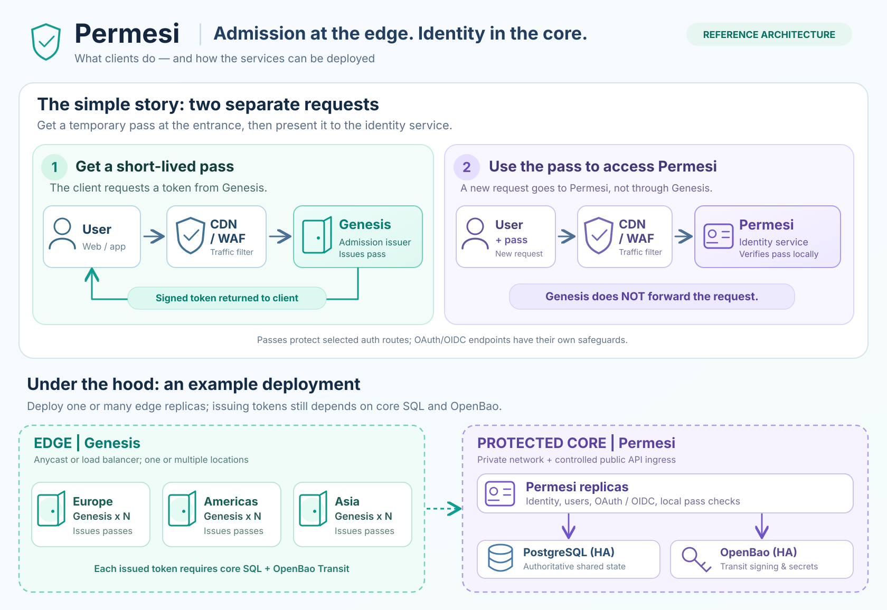

# Permesi

Identity and Access Management (IAM) and OpenID Connect (OIDC) provider.

[](https://github.com/permesi/permesi/actions/workflows/build.yml)
[](https://github.com/permesi/permesi/actions/workflows/security-audit.yml)
[](https://codecov.io/gh/permesi/permesi)
[](https://github.com/permesi/permesi/releases)
[](https://permesi.github.io/permesi/)
[](LICENSE)



> **Documentation:** Browse the full **[Documentation Index](docs/README.md)** for system architecture, authentication, OAuth 2.0 / OIDC, database hardening, governance, and CI guides. For production deployment, see [SETUP.md](SETUP.md).

## Architecture

Permesi uses a **split-trust architecture** backed by **PostgreSQL 19** and **OpenBao 2.7** to isolate public edge traffic from core identity logic while keeping all service replicas stateless.

- **`genesis` (Edge Admission Mint):** Accepts public admission requests, persists short-term audit metadata in partitioned PostgreSQL tables, signs short-lived PASETO `v4.public` (Ed25519) admission/zero tokens via OpenBao Transit, and publishes its PASERK public keyset at `GET /paserk.json`.
- **`permesi` (Core IAM & OIDC Authority):** Verifies Genesis tokens **locally** via a PASERK keyset (inline JSON for fully offline operation, or cached `/paserk.json` refreshed on startup, stale TTL—including `/ready` and `/health` probes—or unknown `kid`), and manages OPAQUE password auth, discoverable passkeys/MFA, multi-tenant resources, and OAuth 2.0 / OIDC protocol flows using shared PostgreSQL state across replicas.
- **`apps/web` (Web Console):** Static client-side-rendered (CSR) Leptos WebAssembly admin console built with Trunk and Tailwind CSS.

See [System Architecture](docs/architecture.md) for trust boundaries, cryptography, multi-replica authentication flows, and authority separation.

## Capabilities

### Implemented

- **Authentication & Registration:** Client-side OPAQUE signup/login/reauthentication and discoverable WebAuthn passkeys backed by AEAD-sealed shared PostgreSQL exchanges ([OPAQUE](docs/opaque-exchanges.md), [WebAuthn](docs/webauthn-exchanges.md)), TOTP/security-key/recovery MFA with recency checks and terminal challenge lockouts ([MFA lifecycle](docs/mfa-lifecycle.md)), signup admission modes and TLS SMTP/outbox delivery ([registration security](docs/registration-security.md)), and shared IP/account/pending-state quotas ([authentication operations](docs/authentication-operations.md)).
- **Multi-Tenant Resources:** Organization → Project → Environment (`0..1` active `production`, unlimited `non_production`) → Application hierarchy with explicit bottom-up soft deletion ([resource lifecycle](docs/resource-lifecycle.md)) and configurable handler/lock deadlines ([tenant mutation deadlines](docs/tenant-mutation-deadlines.md)).
- **OAuth 2.0 & OIDC:** Application-owned public/confidential clients, exact redirect allow-lists, `<resource>:<action>` API scopes and immutable OIDC scopes, confidential-client Argon2id secret rotation, Authorization Code + S256 PKCE with tenant-bound consent, transactional `POST /token` with OpenBao-signed RS256 access (`at+jwt`) and ID tokens, `/jwks.json` and discovery, rotating refresh-token families with reuse revocation, `POST /revoke`, `GET`/`POST /userinfo`, and user Connected apps grant revocation ([OAuth foundation](docs/oauth-foundation.md), [token exchange](docs/oauth-token-exchange.md), [refresh tokens](docs/oauth-refresh-tokens.md)).
- **Platform Governance & Security:** Read-only global tenant inspection for platform operators ([tenant inspection](docs/admin-tenant-inspection.md)), auditable account suspension/reactivation ([account containment](docs/account-containment.md)), two-operator designation lifecycle ([operator designation](docs/operator-designation.md)), and non-superuser PostgreSQL ownership with least-privilege runtime grants ([database hardening](docs/database-hardening.md)).

### Planned

Tracked in [TODO.md](TODO.md): OAuth token introspection and immediate access-token revocation, `client_credentials` (M2M) and Device Authorization grants, formal OIDC conformance testing, broader administrator grant/audit views, fair hierarchical lock coordination, PostgreSQL RLS evaluation, and open stabilization items.

## Workspace Layout

This repository is a Rust workspace (2024 edition) with a single shared version across crates:

- `services/permesi`: Core IAM / OIDC service ([README](services/permesi/README.md))
- `services/genesis`: Edge admission token mint ([README](services/genesis/README.md))
- `apps/web`: Leptos CSR web console ([README](apps/web/README.md))
- `crates/admission_token`: Shared PASETO / PASERK admission token contract and sign/verify helpers
- `crates/openbao_client`: Shared OpenBao HTTP/Unix/Kubernetes client and lease renewal
- `crates/service_utils`: Shared error envelopes, request IDs, shutdown draining, and transaction startup helpers
- `crates/test_support`: Disposable PostgreSQL 19 and OpenBao 2.7 integration test fixtures
- `tools/oauth_scenario`: Standalone multi-replica OAuth/HA integration runner ([docs](docs/oauth-scenarios.md))

SQL schemas and bootstrap scripts live in `db/sql/` ([README](db/sql/README.md)); OpenBao OpenTofu provisioning lives in `openbao/contrib/opentofu/` ([README](openbao/contrib/opentofu/README.md)); OpenAPI contracts live in `docs/openapi/`.

## Quick Start (Full Local Stack)

### Prerequisites

- **System:** `zsh` (required by the justfile), `podman`, `jq`, `curl`, `xh`, `ripgrep` (`rg`), and [`herdr`](https://herdr.dev) (or `tmux` as fallback)
- **Languages:** `rust` (stable) with `cargo-watch`, `node` (LTS, for Tailwind CSS builds)
- **Infrastructure:** `just`, `tofu` ([OpenTofu](https://opentofu.org) v1.11+), `openbao` (`bao` CLI), `mkcert`, `direnv`

```bash
# 1. Clone the repository
git clone https://github.com/permesi/permesi.git
cd permesi

# 2. Check the host: tools, ports, name resolution, network, and OpenBao state
just doctor

# 3. Allow binding to privileged port 443 on Linux for local HAProxy,
#    or skip this step by setting: export PERMESI_HTTPS_PORT=8443
just haproxy-sysctl

# 4. Start PostgreSQL 19, OpenBao, Jaeger, HAProxy, genesis, permesi, and the web console
just start

# 5. (Optional) Launch Firefox Developer Edition with an isolated profile trusting local mkcert
just firefox
```

*Historical local startup walkthrough (recorded before the OpenBao and Herdr migration):*

[](https://asciinema.org/a/782038)

**Local endpoints** (append `:$PERMESI_HTTPS_PORT` when not using `443`):

- **Web Console:** `https://permesi.localhost`
- **Permesi API:** `https://api.permesi.localhost/health`
- **Genesis API:** `https://genesis.permesi.localhost/health`
- **Jaeger Tracing UI:** `http://localhost:16686`
- **OpenBao UI:** `http://localhost:8200`

### Local Development Notes

- **Transport:** `just start` runs HAProxy with mkcert TLS termination and forwards to `genesis` (`:8000`) and `permesi` (`:8001`) over OpenBao-issued TLS (matching production/Kubernetes) and to the local Trunk `web` dev server (`:8081`) over HTTP. `just start-socket` is an opt-in same-host alternative using Unix domain sockets under `.tmp/` (not portable across pods/hosts). `just start-http` is an alias for `just start`.
- **Multiplexer:** `just start` opens panes in a `permesi-dev` Herdr workspace and falls back to a `tmux` session named `permesi`. Override with `PERMESI_MUX=herdr|tmux|none` (`none` starts only infra and prints service commands) or `PERMESI_NO_ATTACH=1`. Re-attach with `just attach`, inspect output with `just logs [genesis|permesi|web]`, or start infra alone with `just infra` followed by `just genesis`, `just permesi`, and `just web` in your own terminals.
- **Host binding & ports:** `PERMESI_BIND_ADDR` (default `127.0.0.1`) controls where infra containers publish ports. **Do not set `PERMESI_BIND_ADDR=0.0.0.0` on an untrusted network:** local PostgreSQL runs with `POSTGRES_HOST_AUTH_METHOD=trust` (passwordless `postgres` superuser) and `openbao/keys.json` holds the OpenBao root token; use the SSH tunnel in [Remote VM Development](#remote-vm-development) instead. `PERMESI_HTTPS_PORT` (default `443`) controls the browser-facing HAProxy port and is propagated into `.envrc`, CORS, and passkey origins. On shared or cloud hosts, keep the host firewall closed to everything except SSH, because the dev `genesis`, `permesi`, and `trunk` processes bind all interfaces so HAProxy can reach them via `host.containers.internal`.
- **Isolated browser helper:** `just firefox-install` installs Firefox Developer Edition under `~/.local/opt`; `just firefox` launches an isolated `dev` profile importing the laptop's mkcert public CA only (`TRUST_MKCERT_CA=0 just firefox` disables import) and opens the console, API health, Jaeger, and OpenBao tabs (defaulting to port `8443`; set `PERMESI_HTTPS_PORT=443` when using `443`).
- **Platform operator claim:** `just dev-envrc` exports `PERMESI_OPERATOR_TOKEN` (never printed to startup logs). Navigate to `https://permesi.localhost/admin/claim` (or mint a fresh token with `just operator-token`) and submit it to claim the platform operator role.
- **Database connection:** Run `PGSERVICEFILE="$PWD/.pg_service.conf" psql service=permesi-dev` from the repo root.
- **Container network & cleanup:** Dev containers run on the dedicated `permesi-net` (`172.31.20.0/24`) network (override with `PERMESI_NET` / `PERMESI_SUBNET`). Integration tests use isolated `permesi-test-*` networks; `just test-clean` (also invoked by `just stop`) removes **every** `permesi-test-*` container and network owned by your Podman user, so do not run it while tests in any Permesi checkout are active.

### Common Development Recipes

| Recipe | Purpose |
| --- | --- |
| `just status` | Read-only health check across containers, PostgreSQL 19, OpenBao, and both services |
| `just signup-verify-url` | Extract the latest email verification link from the local outbox database |
| `just operator-token` | Mint a fresh OpenBao token with the `permesi-operators` policy |
| `just db-bootstrap` / `just db-verify` | Reapply canonical SQL bootstrap and verify constraints |
| `just dev-tls-certs` | Refresh 24-hour local OpenBao backend TLS certificates without restarting services |
| `just openapi` / `just openapi-check` | Regenerate `docs/openapi/*.json` or verify byte-for-byte parity |
| `just stop` / `just reset` | Stop the dev stack or wipe local OpenBao data and `db/data/19` |

### Remote VM Development

You can run the full stack on a remote Linux VM while using your laptop's browser at `https://permesi.localhost:8443`. The laptop only needs a checkout of this repo, `mkcert`, and SSH; the laptop's mkcert CA private key never leaves the laptop.

On the VM (once):

```bash
# Install zsh, rootless podman, jq, and curl from OS packages; install remaining tools via mise
mise trust && mise install
loginctl enable-linger "$USER"
git clone https://github.com/permesi/permesi.git ~/permesi
cd ~/permesi && just doctor
```

On the laptop:

```bash
export PERMESI_HTTPS_PORT=8443     # set the same port on the VM (e.g. ~/.zshenv)
scripts/dev-remote --start <vm>    # push leaf cert + public CA, forward ports, start session
scripts/dev-remote --stop <vm>     # close the SSH tunnel; remote services keep running
```

`just remote-start <vm> [remote-repo-path]` wraps this flow (defaulting to port `8443` and `~/permesi`). Disable automatic IDE port forwarding (such as `"remote.autoForwardPorts": false` in VS Code) so CORS and passkey origins stay on the exact forwarded port.

## OpenBao Dependency

OpenBao is required in production for both `genesis` and `permesi` (dynamic database credentials, Transit signing/encryption, KV v2 OPAQUE seed and MFA pepper, and internal PKI). Running without OpenBao is not supported.

Supported connectivity modes (`PERMESI_OPENBAO_URL` / `GENESIS_OPENBAO_URL`):

1. **Agent Mode (recommended):** Unix socket path (`/run/openbao/proxy.sock` or `unix:///run/openbao/proxy.sock`) to an OpenBao Agent `api_proxy` configured with `use_auto_auth_token = true`. No AppRole credentials are required. *(Note: OpenBao 2.7 logs that `api_proxy` is migrating from `bao agent` to `bao proxy`; review sidecar config when upgrading.)*
2. **TCP AppRole Mode:** `https://...` with `--openbao-role-id` and `--openbao-secret-id` (or single-use `--openbao-wrapped-token`).
3. **Native Kubernetes Mode (opt-in):** `--openbao-auth-method kubernetes` with `--openbao-kubernetes-role` and a projected ServiceAccount token.

See [openbao/README.md](openbao/README.md#production-readiness-checklist) and [SETUP.md](SETUP.md) for OpenTofu provisioning, production HA readiness, and lease renewal behavior.

## Build, Testing & Containers

### Building

```bash
cargo build -p permesi
cargo build -p genesis
cargo build -p permesi --features telemetry   # enables OTLP trace export (default off)
```

OTLP trace export is behind the default-off `telemetry` Cargo feature; container images, release artifacts, and `just` dev recipes enable it. When enabled, traces export only if `OTEL_EXPORTER_OTLP_ENDPOINT` is set (local dev points to Jaeger at `http://localhost:4317`).

For the web console:

```bash
just web         # Tailwind watch + Trunk dev server
just web-build   # Production static bundle in apps/web/dist
```

Frontend configuration (`PERMESI_API_BASE_URL`, `PERMESI_TOKEN_BASE_URL`, `PERMESI_CLIENT_ID`) is compiled into WASM and can be overridden at runtime via `config.js`. All frontend values are public; never store secrets there.

### Testing

- **Full local validation:** `just test` (formatting, native & WASM Clippy, release web build, and workspace tests).
- **Browser tests:** `just web-test-browser` builds the console and runs the Chromium fixture suite plus real PostgreSQL authorization, OPAQUE deletion, and admin inspection browser tests (`just web-test-browser-built` reuses an existing build).
- **Isolated multi-replica OAuth & HA scenarios:** On a clean checkout, install the Better Auth fixture's Node 24 dependencies once with `just oauth-scenario-better-auth-setup` before running the default `full` or `interop` suites. Then run `just oauth-scenario` to launch disposable PostgreSQL 19, OpenBao 2.7, Genesis, 3–5 Permesi replicas, the compiled Web console, and Chromium (`--suite smoke`, `--suite ha`, `--suite token`, `--suite refresh`, `--suite interop --access-token-ttl-seconds 10`, or `--replicas 5 --suite full`). See [docs/oauth-scenarios.md](docs/oauth-scenarios.md).

### Containers & Production Bootstrap

- **Images:** `just image-permesi`, `just image-genesis`, or `just images` compile static `x86_64-unknown-linux-musl` binaries into `dist-bin/` and package them with Podman (`podman build -f apps/web/Dockerfile -t web:dev .` builds the nginx web image). Dockerfiles copy `dist-bin/<service>` rather than compiling Rust.
- **Database bootstrap:** `db/sql/` is the canonical schema source for both local dev and bare-metal/Kubernetes deployments. Before running `db/sql/00_init.sql` in production, update the placeholder passwords and remove the `\ir seed_test_client.sql` include line inside `00_init.sql` (do not delete the file while the include remains, or `ON_ERROR_STOP=1` will abort mid-bootstrap). If loading `db/sql/01_genesis.sql` and `db/sql/02_permesi.sql` manually instead of `00_init.sql`, create the runtime roles first and connect as each service's dedicated non-superuser owner role. Register scheduled maintenance via `db/sql/cron_jobs.sql`, and follow [SETUP.md](SETUP.md) and [docs/database-hardening.md](docs/database-hardening.md) for ownership and grant setup.

## Contributing & Security

- [CONTRIBUTING.md](CONTRIBUTING.md) — Development workflow, test gates, commit rules, and release process.
- [AGENTS.md](AGENTS.md) — Mandatory coding, documentation, and security invariants.
- [AI_POLICY.md](AI_POLICY.md) — Policy on AI-assisted contributions and human accountability.
- [CHANGELOG.md](CHANGELOG.md) — Release history.
- [Security Policy](.github/SECURITY.md) — Private vulnerability reporting procedure.
