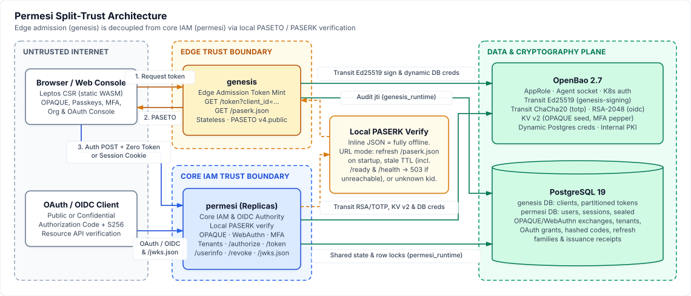
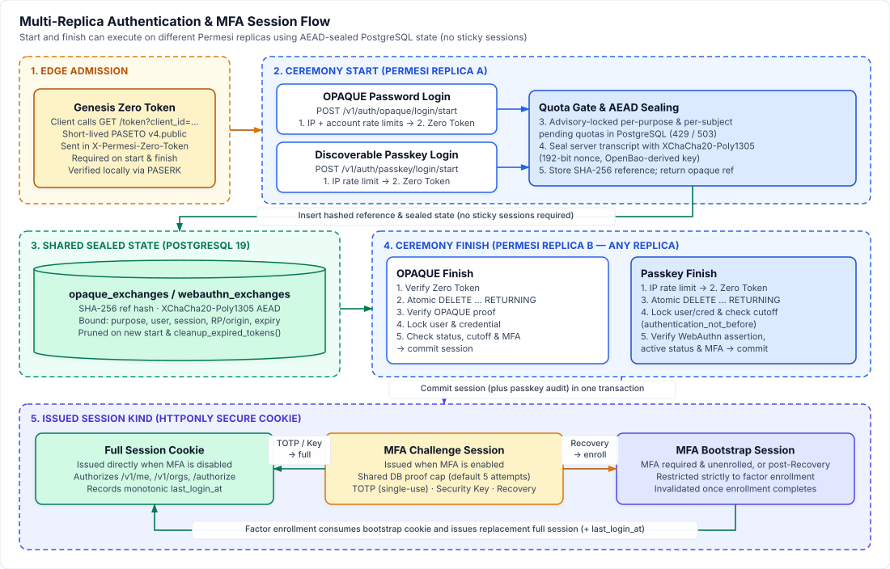
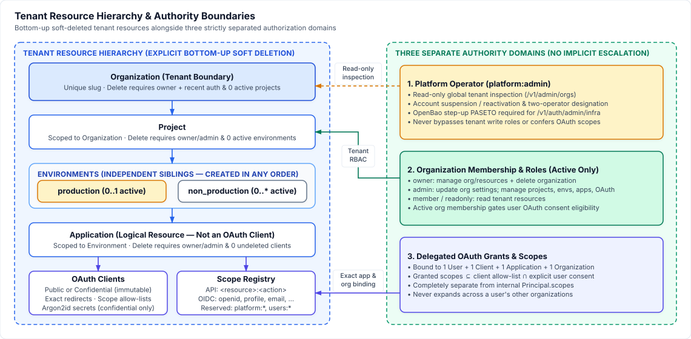

# System Architecture

Permesi is an identity and access management (IAM) and OpenID Connect (OIDC) provider built around a **split-trust architecture**, **OpenBao-backed cryptography**, and **shared PostgreSQL 19 state** across stateless service replicas.

*Source: [diagrams/split-trust-architecture.d2](diagrams/split-trust-architecture.d2)*

## Core Components

### 1. `genesis` (Edge Admission Mint)

- **Role:** Public-facing edge service that sits between untrusted network traffic and core identity handlers.
- **Responsibilities:** Validates client identifiers, captures edge request metadata (IP, country, user agent), persists minted token IDs (`jti`) in range-partitioned PostgreSQL tables for short-term auditability, and issues short-lived **Admission Tokens** (also referred to as **Zero Tokens** on auth POST routes).
- **Cryptography:** Signs PASETO `v4.public` (Ed25519) tokens via OpenBao Transit (`transit/genesis/sign/genesis-signing`). Private signing keys never leave OpenBao.
- **Key publication:** Exposes its public keyset as PASERK at `GET /paserk.json`.
- **Edge abuse controls:** Production deployments currently rely on network-edge filtering (for example, Cloudflare WAF) while native rate limiting and proof-of-work challenges remain on the [Genesis roadmap](../services/genesis/README.md#roadmap).

### 2. `permesi` (Core IAM & OIDC Authority)

- **Role:** Stateless horizontally scalable IAM/OIDC backend.
- **Responsibilities:**
  - User registration, mailbox verification, and outbox/SMTP delivery ([registration security](registration-security.md)).
  - Passwordless/password authentication via client-side OPAQUE and discoverable WebAuthn passkeys ([OPAQUE exchanges](opaque-exchanges.md), [WebAuthn ceremonies](webauthn-exchanges.md)).
  - TOTP, hardware security keys, and recovery codes with strict session lifecycle transitions ([MFA lifecycle](mfa-lifecycle.md)).
  - Multi-tenant Organization → Project → Environment → Application management ([resource lifecycle](resource-lifecycle.md)).
  - OAuth 2.0 / OIDC client and scope management, Authorization Code + S256 PKCE, transactional RS256 token exchange, rotating refresh families, UserInfo, and revocation ([OAuth foundation](oauth-foundation.md)).
  - Platform-operator governance: read-only global tenant inspection, auditable account containment, and two-operator designation ([account containment](account-containment.md), [operator designation](operator-designation.md)).
- **Local admission verification:** Verifies Genesis Admission/Zero Tokens locally using a PASERK keyset (`sig`, `iss`, `aud`, `action`, `iat`/`exp`, and TTL bounds). The verifier receives versioned public keys and the withdrawal floor from core OpenBao.

### 3. `apps/web` (Web Console)

- **Role:** Static client-side-rendered (CSR) Leptos WebAssembly application built with Trunk and Tailwind CSS.
- **Trust model:** Runs entirely in the browser with no server-side secrets. All access control is enforced by `permesi` over HTTPS using `HttpOnly` session cookies (the elevated infrastructure view is a short-lived server-side step-up of the same session). See [apps/web/README.md](../apps/web/README.md).

### 4. PostgreSQL 19 & OpenBao 2.7 (Data & Cryptography Plane)

- **PostgreSQL 19:** Dedicated `genesis` and `permesi` databases owned by non-superuser OpenBao root roles (`openbao_genesis`, `openbao_permesi`). Running replicas connect with short-lived dynamic logins that inherit least-privilege `genesis_runtime` or `permesi_runtime` groups ([database hardening](database-hardening.md)).
- **OpenBao 2.7:** Mandatory dependency providing:
  - Dynamic PostgreSQL credentials with lease renewal and fail-closed shutdown before expiry.
  - Transit cryptographic engines: Ed25519 (`genesis-signing`), ChaCha20-Poly1305 (`totp`), and RSA-2048 (`oidc-signing`).
  - KV v2 secrets (`secret/permesi/config`): `opaque_server_seed` and `mfa_recovery_pepper`.
  - Internal PKI for service-to-service TLS bundles and agent cert-auth bootstrap.
  - Three connectivity modes: **Agent Unix socket** (recommended), **AppRole TCP**, and opt-in **native Kubernetes auth** ([OpenBao guide](../openbao/README.md)).

## Local Admission Token Verification

Admission and Zero Tokens decouple edge admission from core identity traffic:

1. `genesis` signs a PASETO `v4.public` token in OpenBao Transit and places the PASERK key ID (`k4.pid...`) in the footer as `kid`.
2. `permesi` parses the footer `kid`, resolves the matching `k4.public...` key in its PASERK keyset, and verifies the Ed25519 signature locally.
3. `permesi` validates `iss`, `aud`, `action`, `iat`, `exp`, and TTL bounds, rejecting any mismatch before touching application state.

Core OpenBao owns the KV v2 record `admission-authority` under Permesi's KV mount.
A background reader begins with an empty snapshot and accepts only approved Ed25519
versions at or above its minimum. The default refresh interval is 15 seconds and
the maximum age is 60 seconds, measured from the start of each successful read.
Unknown key IDs and expired observations fail locally. Existing session and OAuth
handlers retain their own database, session, client and token checks. Both APIs
are public entry points. Network placement of Genesis grants no identity authority.

Genesis inserts its receipt before signing. Both services enforce local rate,
burst and in-flight ceilings before handler work. Permesi reserves an independent
budget for session inspection, logout, OIDC discovery, authorization, token,
revocation and UserInfo requests. The shared SQL abuse controls still apply.
Health probes read background observations. A core replica with healthy SQL and
unavailable admission remains ready and reports `degraded`; Genesis checks SQL
and a fixed non-token Transit signature.

`active_kid` is used only by `genesis` when selecting the signing key; verification always matches the token's footer `kid`.

## Multi-Replica Authentication & Session Flow

No user authentication ceremony, rate limit, or OAuth state relies on process-local memory or sticky sessions. Start and finish requests can land on different `permesi` replicas behind any load balancer. Platform-operator admin elevation for `/v1/auth/admin/infra` follows the same rule: it is a PostgreSQL row tied to the session, readable by every replica.

*Source: [diagrams/auth-session-flow.d2](diagrams/auth-session-flow.d2)*

Key invariants:

- **Client-side OPAQUE:** User passwords never leave the browser. PostgreSQL stores permanent registration records (`opaque_registration_record`) and transient, single-attempt, XChaCha20-Poly1305 AEAD-sealed ceremony rows (`opaque_exchanges`).
- **Discoverable Passkeys & Hardware Keys:** All four WebAuthn ceremonies persist sealed `webauthn-rs` state in `webauthn_exchanges` with SHA-256 reference hashes and database-clock expiry.
- **Atomic consumption & identity locking:** Finish handlers delete and return the pending exchange row before interpreting the proof, then lock the user and credential rows in PostgreSQL before checking `users.status`, `authentication_not_before`, and MFA state.
- **Consistent MFA enforcement:** If TOTP or security keys are enabled on an account, both password and passkey logins issue a scoped MFA challenge session backed by a shared PostgreSQL failure counter before issuing a replacement full session cookie.

## Cryptography Summary

| Surface | Primitive / Backing | Key Custody & Notes |
| --- | --- | --- |
| Admission / Zero Tokens | PASETO `v4.public` (Ed25519) | Signed in OpenBao Transit (`transit/genesis/keys/genesis-signing`); verified locally using a fresh core OpenBao snapshot. |
| User passwords | OPAQUE (Ristretto255 / TripleDH / SHA-512 / Argon2 via `opaque-ke`) | Server setup derived from 32-byte `opaque_server_seed` in OpenBao KV v2. |
| Transient auth ceremonies | XChaCha20-Poly1305 (random 192-bit nonce) | Separate HMAC-derived key domains from `opaque_server_seed` for OPAQUE and WebAuthn; 2^48 encryption ceiling per key. |
| TOTP secrets | Envelope encryption (ChaCha20-Poly1305) | Data keys protected by OpenBao Transit (`transit/permesi/keys/totp`); plaintext seeds never stored in PostgreSQL. |
| MFA recovery codes | Keyed hash | Peppered with `mfa_recovery_pepper` from OpenBao KV v2. |
| OAuth confidential client secrets | Salted Argon2id PHC (`19456` KiB, 2 iterations, parallelism 1 default) | Canonical `pcs.<uuid>.<base64url>` issued once; verified with bounded worker permits. |
| OAuth access & OIDC ID tokens | RS256 (`RSA-2048`, SHA-256 / PKCS#1 v1.5) | Signed in OpenBao Transit (`transit/permesi/keys/oidc-signing`); public versions published at `/jwks.json` with RFC 7638 `kid`. |
| Authorization codes, refresh tokens & email tokens | 256-bit OS-random values | Only SHA-256 hashes persist in token tables; `email_outbox.payload_json` stores the verification link only while a delivery can still need it; the payload is erased in the statement that marks the row delivered or abandoned. |

## Tenant Model & Authority Separation

Permesi enforces strict boundaries between **platform administration**, **tenant RBAC**, and **delegated OAuth grants**. None of these domains implicitly escalates into another.

*Source: [diagrams/tenant-authorization-model.d2](diagrams/tenant-authorization-model.d2)*

- **Tenant hierarchy:** Organizations own Projects, Projects own independent sibling Environments (`0..1` active `production` and any number of `non_production`), and Environments own logical Applications. Applications own multiple OAuth clients and a delegated scope registry. Resources are soft-deleted explicitly from the bottom up ([resource lifecycle](resource-lifecycle.md)).
- **Platform operators (`platform:admin`):** Authorized via `platform_operators` for read-only global inspection (`/v1/admin/orgs`), auditable account containment, and two-operator designation. OpenBao step-up elevation records a short-lived, session-bound grant for `/v1/auth/admin/infra`. Platform operators cannot bypass organization write roles or grant themselves OAuth scopes.
- **Organization roles (`owner`, `admin`, `member`, `readonly`):** Checked server-side against active `org_memberships`. Unauthorized or foreign tenant routes return `404` to avoid resource enumeration.
- **Delegated OAuth scopes:** Distinct from internal `Principal.scopes`. Application scopes follow `<resource>:<action>` (with `platform:` and `users:` namespaces reserved), while OIDC protocol scopes (`openid`, `profile`, `email`, `address`, `phone`, `offline_access`) are system-managed. Every grant binds one user, one client, one application, and one owning organization.

## Graceful Shutdown & Fail-Closed Behavior

Both `genesis` and `permesi` handle `SIGTERM` / `SIGINT` by stopping new accepts, draining in-flight requests for up to 20 seconds by default (`--shutdown-drain-seconds`; a second signal ends the drain at once), stopping background workers cleanly (including the email outbox worker in `permesi`), flushing OTLP telemetry, removing Unix sockets if bound, and closing the PostgreSQL pool.

When an OpenBao token or dynamic database lease approaches its max TTL (within 1 minute) or fails renewal past the drain margin — or when readiness checks detect PostgreSQL authentication failures — the service initiates the same graceful drain and exits non-zero so the supervisor (systemd, Kubernetes, or Podman) restarts it with fresh credentials.

Permesi selects the management bucket by route before it verifies the caller. Organization, user, account and administrator paths share this bucket, including requests that subsequently fail authentication. Operators needing guaranteed access under direct traffic must also constrain network ingress. This bucket takes the configured protocol rate, burst and concurrency values, with independent counters. Private diagnostics report admission snapshot age on refresh failure and active OAuth credential-hashing workers.
