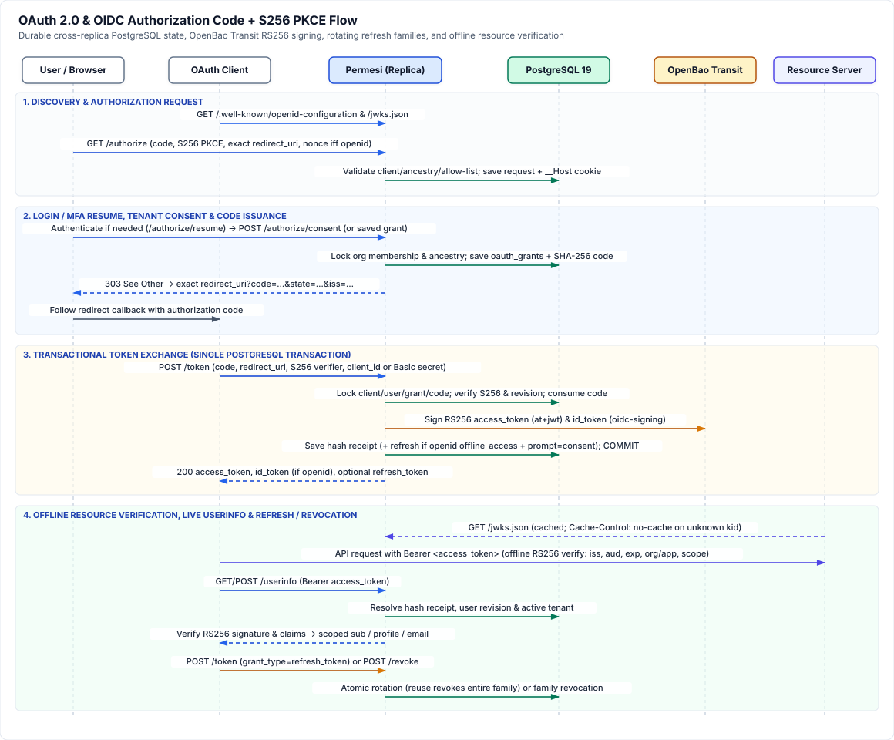

# OAuth/OIDC foundation

The standalone [OAuth scenario runner](oauth-scenarios.md) exercises real services,
Web login/consent, shared PostgreSQL code state and tenant/credential lifecycles on a
disposable stack. Its coverage matrix distinguishes browser/HTTP checks from internal
redemption, runtime-role HTTP issuance and rotating refresh families; broader token services remain deferred.

Permesi implements identity/authentication, sessions, organization authorization,
OAuth registration management, Authorization Code + S256 PKCE, and [transactional
token exchange](oauth-token-exchange.md) with signed access/OIDC ID tokens. Applications retain their existing logical-tenant meaning and
own multiple clients, each with an immutable public/confidential classification.
For example one production Crono application can own crono-web, crono-cli, and
crono-worker with independent configuration. Classification alone enables no flow;
a confidential worker still needs a separately defined client-credentials policy
before it can obtain machine-grant tokens.

The Rust `oauth` module owns client types, scope tokens, redirect validation, grant
context, and transactional persistence. HTTP adapters require a full session,
resolve active organization membership using existing policy, check owner/admin
for writes, and resolve the complete active application ancestry before invoking
that layer. Global platform capabilities do not bypass org checks. Non-members,
inactive memberships, unauthorized writes, wrong ancestry, and foreign-client IDs
return 404; missing/partial sessions return 401. Database details and submitted
security configuration are excluded from error logs.

## Persistence and identifiers

`oauth_clients` belongs to `applications`. The internal `id` and public `client_id`
are independently generated UUIDv4 values. The public value is suitable for exposure
and remains globally unique after deletion; it is never a credential. Names are
unique among non-deleted clients in an application. Client type, identifiers, and
application binding cannot change through the API. Disabled clients remain visible
to managers for remediation; deleted clients are hidden. The reusable active-client
loader rejects disabled/deleted clients and any deleted ancestor.

`oauth_client_redirect_uris` stores exact URI strings with per-client uniqueness.
Reserved OAuth/OIDC response query keys, including encoded equivalents, are rejected
at registration and before establishing authorization redirect trust, including for legacy rows.
`oauth_scopes` stores case-sensitive tokens, descriptions, and a protocol/application
kind in each application. Fixed protocol records are seeded for existing/new
applications. `oauth_client_scopes` connects registrations to that application's
registry using composite foreign keys. These prevent cross-application assignments,
even through direct SQL. API scope deletion removes dependent allow-list and grant
edges; recreating the name creates a new ID and does not restore client authority.

`oauth_client_secrets` stores salted Argon2id PHC hashes for confidential clients only.
The composite foreign key enforces that classification; plaintext is never persisted.
The service issues 256 random bits in canonical `pcs.<credential-uuid>.<base64url>` form,
returns plaintext once, and validates Argon2id v19, supported costs, salt and output
before verification. Registration/metadata DTOs never include hashes or secrets.
A supplied value cannot upgrade a public client to confidential. Client authentication
method policy is enforced by `/token`: Basic for confidential clients and public `none`,
both with S256 and an existing user authorization code. The machine grant is separate.

`oauth_grants` binds one user, client, application, and explicit owning organization.
A membership foreign key and ancestry/lifecycle trigger reject an unrelated tenant
context at grant creation. The trigger share-locks the client, all ancestors, and
membership before accepting the grant, serializing consent with lifecycle and
membership mutations while allowing concurrent consent writers. Keep consent
transactions short; future parent lifecycle operations that also lock clients must
lock top-down. `oauth_grant_scopes` references both the grant context and
the client's configured scope edges, preventing arbitrary or foreign scopes. One
non-revoked grant per user/client/organization is permitted. Revocation is permanent;
reauthorization must create a new grant. Revoking still succeeds after membership
suspension or lifecycle changes. Registration management still creates no implicit grants. The authorization
flow records consent only after a bound full session explicitly allows the exact
validated request; saved grants may skip that minimal screen.

Identity and organization authorization are separate trust boundaries. A user's
membership in several organizations never expands one grant to all of them. The
chosen resource context is the exact client application within its owning organization;
cross-organization/resource delegation is intentionally unsupported by this phase.
Authorization and transactional code redemption recheck active membership,
resource ancestry, all lifecycle states, and consent. Code and refresh-token issuance preserve those checks. Parent resources have no move API;
any future hierarchy move must invalidate grants and enforce their tenant context.
Persisted membership or consent alone never proves current authorization.

Disabling/deleting a client revokes its credentials and saved grants. Re-enabling
does not restore either. Replacing redirect or scope allow-lists revokes saved
consent conservatively and commits atomically under a client lock. Failed validation
rolls back every change, including revocation. An empty scope allow-list delegates
no authority, and an empty redirect allow-list permits no interactive redirect flow.

Tenant resources now support explicit [bottom-up soft deletion](resource-lifecycle.md).
An application requires all its OAuth clients to be explicitly deleted first, including
disabled registrations. This preserves the existing atomic client/credential/consent
revocation service. Scope registry metadata never prevents application deletion. Empty
environments, projects and organizations can then be removed without recursive cascades;
organization deletion requires its owner and the existing recent-authentication policy.
The console uses server-issued role capabilities and a UUID-pinned confirmation. Inline
OPAQUE password verification returns to confirmation after refreshing identity, authority
and children; it never deletes automatically. This reuses current authentication semantics.
OPAQUE login/reauthentication now uses shared encrypted PostgreSQL state, independently
of OAuth request/code persistence. Reauthentication binds the exact original full session;
see [shared authentication exchanges](opaque-exchanges.md).
Creation and deletion coordinate through transaction-owned PostgreSQL parent locks.
Deleted ancestry cannot authorize outstanding requests or redeem old codes.
Future immediate JWT revocation and cache policy must account for these configuration changes;
signed-token revocation limits are documented in [token exchange](oauth-token-exchange.md); refresh uses [rotating tenant-bound families](oauth-refresh-tokens.md).

Apply the additive canonical `db/sql/02_permesi.sql` script to an existing database
as the role that owns its existing tables with `ON_ERROR_STOP=1` before deploying the
new binary. The owner of the public schema alone may not own those tables. Reapplication
seeds missing protocol scopes and preserves existing registrations. No RLS is added.

## Management API

The base is
`/v1/orgs/{org_slug}/projects/{project_slug}/envs/{env_slug}/apps/{app_id}/oauth`.
Applications currently have no slug, so `app_id` is the existing application UUID.
Client paths use the public `client_id`; scope paths use registry UUIDs.

| Method | Suffix | Behavior |
| --- | --- | --- |
| POST, GET | `/clients` | Create or list client registrations |
| GET, PATCH, DELETE | `/clients/{client_id}` | Inspect, update name/disabled state, or soft-delete |
| GET, PUT | `/clients/{client_id}/redirect-uris` | Inspect or atomically replace exact redirects |
| GET, PUT | `/clients/{client_id}/scopes` | Inspect or atomically replace delegated scope names |
| POST, GET | `/scopes` | Define an API scope or list API/protocol entries |
| PATCH, DELETE | `/scopes/{scope_id}` | Update API description or delete API authority |

Client creation accepts `name`, `client_type`, and optional `redirect_uris`/`scopes`
arrays (default empty). PATCH accepts `name` and/or `disabled`; classification is
immutable. PUT payloads contain `redirect_uris` or `scopes`; an empty array removes
that allow-list. Scope creation accepts `name` and optional `description`; only the
description may be patched. Unknown request fields are rejected. Responses expose
reviewed registration/registry fields, never credential hashes or internal permissions.
Configuration errors and JSON parsing errors return 400. Payload deserialization
errors such as unknown fields return 422; the parser also classifies invalid enum
shapes as 400. Missing JSON content type returns 415, and uniqueness conflicts
return 409. OpenAPI registers these management endpoints
under `oauth-clients` and `oauth-scopes` without protocol placeholders.

## Redirect and scope policy

Redirect registration uses the existing URL parser to validate structure while
retaining original bytes for storage and exact comparison, following
[RFC 9700 §2.1](https://www.rfc-editor.org/rfc/rfc9700.html#section-2.1).
It accepts absolute HTTPS for either client type. Only public clients may register
HTTP with canonical `127.0.0.1` or `[::1]` authorities. It rejects fragments,
wildcards, userinfo, whitespace/control characters, backslashes, non-ASCII URIs,
malformed percent escapes, parser-repaired authorities, relative URIs, other HTTP
hosts, and private-use schemes. URIs are capped at 2048 bytes and duplicate original
strings are rejected. Percent-encoded literal characters are not wildcard patterns.
There is no prefix, host-only, case-folded, decoded, or normalized URI comparison.

Loopback ports currently match exactly, too. Native-client application metadata,
private-use schemes, and the
[RFC 8252 loopback ephemeral-port exception](https://www.rfc-editor.org/rfc/rfc8252.html#section-7.3)
must be introduced deliberately before native authorization is supported.
`localhost` DNS names and production HTTP are rejected; use HTTPS for web development
or a public client's canonical loopback IP registration.

Scope names follow the case-sensitive printable ASCII scope-token syntax from
[RFC 6749 §3.3](https://www.rfc-editor.org/rfc/rfc6749.html#section-3.3), capped at
128 bytes. Tokens are not trimmed or lowercased. Permesi's application convention is
`<resource>:<action>`: the resource is the thing being protected and the action is
the operation being delegated. For example, `jobs:read` means delegated permission
to read jobs, and `runs:cancel` delegates cancellation of runs. Actions are defined
by the application; `approve`, `invite`, and `manage` are as valid as `read` or `write`.
The canonical persisted/wire value is still just `name`, not separate resource/action
columns. `ApplicationScope` validates the convention without interpreting action semantics.
Whitespace, controls, quotes, backslashes, empty tokens, and duplicates
are rejected. `openid`, `profile`, `email`, `address`, `phone`, and `offline_access`
are server-defined protocol entries; case variants cannot be defined as API scopes.
The internal `platform:` and `users:` namespaces are also reserved to prevent
misleading overlap with Permesi capabilities.

Application registrations must now contain exactly one colon and two nonempty parts.
Colon-free names (`jobs`, `custom.scope+value`), multi-part names (`urn:example:scope`),
and empty parts (`:read`, `jobs:`, `jobs::read`) are rejected. This is a deliberate
Permesi convention, not an OAuth requirement. OAuth scope tokens themselves remain
opaque, and protocol scopes are system-managed exceptions. Any valid single-colon
application name is interpreted according to this convention; actions are free-form
OAuth-safe strings, not a vocabulary inferred by the server.

This tightens the previous API, which allowed opaque application names. Before
upgrading another installation, audit existing application names for this format.
No rows, assignments, or grants are automatically renamed or deleted. Nonconforming
rows remain visible for explicit cleanup but cannot be newly assigned to clients.
Existing assignments remain until explicitly removed; the console shows unsupported
configured names with removal-only controls and requires removing them before Save.
Create replacement scopes and update client configuration deliberately. The database
schema remains unchanged, retaining its OAuth-token constraints and one name column.

The console creates conventional names from Resource and Action fields, previews
the composed token, and still submits `{name, description}`. Lists show derived
resource/action labels; client allow-lists group conventional names by exact resource,
with immutable OIDC entries in a separate group. No action list is
hard-coded. `users:invite` remains reserved under the existing internal namespace
policy; an application-specific resource such as `members:invite` is allowed.
These are OAuth delegated scopes, completely separate from Permesi internal
permissions such as `platform:admin` and `users:write`. Client assignment establishes
only the maximum scopes a client may request; it does not grant those permissions
to a user or prove tenant authorization.

`Principal.scopes` remains the existing internal permission field. OAuth tokens
are distinct `OAuthScope` values with no Principal conversion. The pure requested-scope
helper fails unless every requested token belongs to both the configured client
allow-list and the independently verified tenant/user authority set. Protocol scopes
require additional OIDC policy: for example
[`offline_access` consent rules](https://openid.net/specs/openid-connect-core-1_0.html#OfflineAccess).
The helper alone does not authorize claims, issue tokens, or validate consent.

## Authorization Code + PKCE

*Source: [diagrams/oauth-oidc-flow.d2](diagrams/oauth-oidc-flow.d2)*

`GET /authorize` validates an active public client identifier, the complete active
application/environment/project/organization ancestry and the exact registered
redirect before it trusts any redirect destination. It supports `response_type=code`
and query responses. Scopes are explicit, space-delimited, case-sensitive registry
names; empty tokens and duplicates fail. Each requested token must be in the client's
allow-list. OIDC claim scopes require `openid`; this phase requires a nonempty nonce
with `openid` and rejects a nonce without it. `offline_access` requires `openid` and
explicit `prompt=consent`, even when saved consent exists; it enables a hashed refresh family. S256 is mandatory for both public
and confidential clients, with canonical 43-character base64url SHA-256 challenges.
There is no plain fallback or omitted-method downgrade. Verifiers must have 43–128
ASCII unreserved characters and their S256 result is compared in constant time,
following [RFC 7636](https://www.rfc-editor.org/rfc/rfc7636.html).

A request can optionally supply `organization_id`; it must equal the organization
resolved from the client's application hierarchy. Without it, the same exact owning
organization is resolved and persisted server-side. Active organization membership
is the current application-resource access policy, matching existing organization
reads. It permits consent only within that application and organization, never across
all of a user's memberships. There is no role-to-OAuth-scope mapping: platform operators
and internal `Principal.scopes` confer no delegated authority. Application APIs remain
responsible for their object/operation authorization; future finer application policy
must be checked here and during redemption instead of inventing delegation from
internal permissions.

`oauth_authorization_requests` snapshots registry IDs and names, exact redirect,
PKCE, state, nonce, application/organization and issuer/resource audience in PostgreSQL.
A random host-only Secure/HttpOnly/SameSite=Lax `__Host-permesi_oauth` cookie binds the
browser to its stored request using a SHA-256 hash. Without a full session the backend
redirects to the existing Web `/login?oauth_request=<opaque UUID>&oauth_expires=<milliseconds>`
route. The frontend retains the locator and a nonauthoritative cleanup deadline in
session storage across login/MFA, returning to `/authorize/resume` only from that flow
when a full session exists. MFA enrollment and recovery-driven re-enrollment wait until
users acknowledge their one-time recovery codes before resuming. Expired locators on login
show a restart notice and are removed from session storage; navigation outside login/MFA
also clears them. If the local deadline passes during MFA, the frontend still asks
`/authorize/resume` to decide. The backend shows a value-free restart page when the
request is unavailable. Restart begins in the requesting application with a fresh
authorization request and PKCE verifier; no browser-provided callback becomes a link.
Changing the browser deadline never changes PostgreSQL expiry. The cookie and
server snapshot enforce integrity; modifying the locator cannot change authority.
Deploy the Web API base URL against the same issuer origin, over HTTPS. All replicas
must share PostgreSQL, session/OPAQUE configuration and issuer/resource audience.
OPAQUE password login/reauthentication exchanges use shared encrypted PostgreSQL state;
WebAuthn/passkey ceremonies also use [shared sealed PostgreSQL state](webauthn-exchanges.md).
No OAuth request/code state depends on process-local state or requires sticky routing.

The first authorized full session is bound permanently by user and session hash.
Resume and consent recheck an active user/session, active membership, every ancestor,
redirect and every original registry ID. Deleting/recreating a scope cannot revive the
snapshot. The minimal backend consent page shows the application/client, organization,
current account email and registered callback origin alongside registry descriptions
and readable system OIDC labels. The email comes from the active session/user lock;
the origin comes from the exact registered redirect. Its scope set is read-only.
To switch accounts after the first full-session binding, the user must cancel, sign
out of Permesi, then restart from the application. A different user or session cannot
inherit that request.
The only form inputs are request locator, random CSRF capability and Allow/Cancel;
unknown form fields fail, and CSRF is bound to that browser and full session. All display
text is escaped and scripts, framing and external resources are prohibited. Consent
responses are never cached. Their CSP omits `form-action`: Chromium applies it to POST
redirects and cannot match registered IPv6 literal callbacks. The server, not CSP,
authorizes the exact registered redirect; the fixed form action and fully escaped display
fields cannot submit scopes or inject another form. Consent uses `Referrer-Policy:
same-origin` so native POSTs carry the real issuer Origin even in browsers without Fetch
Metadata. Other responses use `no-referrer`, including every redirect, so client callbacks
receive no issuer referrer. Opaque `Origin: null` posts still require browser-provided
`Sec-Fetch-Site: same-origin` in addition to browser/session/CSRF proofs. Foreign and
cross-site opaque origins are rejected; non-browser callers omitting Origin require all
stored proofs. Repeated completed consent POSTs and unavailable resume locators return
a generic, friendly 400 page instructing the user to restart from the application,
without reissuing a code or reflecting a callback URL.
`prompt=consent` requires a new explicit decision. `prompt=none` uses saved consent
only and returns `login_required` or `consent_required` when interaction is needed.
Other prompt values, response modes, Request Objects/URIs, claims requests, resource/
audience overrides, max_age, ID-token hints and ACR selection are rejected in this phase.
Unknown extensions are ignored, but known duplicate parameters fail without redirect.

Saved `oauth_grants` remain tenant-bound. An active grant can skip consent only when
it covers all requested registry IDs. Explicit Allow adds exactly those IDs to saved
consent; prior saved authority never enlarges a new code. Cancel permanently completes
the request and returns `access_denied`. Client allow-lists are always maximum authority,
never consent. Configuration changes revoke saved grants under existing client locks.
Client/ancestry/membership and scope checks run independently of the saved grant.
The Connected apps console lists the signed-in user's current grants in pages of 50,
showing the exact client, application, organization and delegated scopes. The
session-authenticated `/v1/me/oauth/grants` API never accepts a user or tenant selector;
the delete route revokes only a grant owned by that user, returning the same 404 for
foreign, unknown and already-revoked IDs. Both responses prohibit caching. Revocation
is permanent and serialized against code redemption and refresh through PostgreSQL
grant row locks. It stops future issuance under that grant, including on other replicas,
but cannot retract a JWT already issued to a resource server. Client, scope and tenant
configuration management remain separate from this user self-service page.

Issuance generates 256 OS-random bits encoded as unpadded base64url and persists only
SHA-256 in `oauth_authorization_codes`. Code rows bind the exact user, client, application,
organization, grant, redirect, scope IDs/names, PKCE, nonce, issuer/resource audience and
session authentication time. Request completion and code insertion commit together;
a unique request key prevents issuing twice. Composite grant foreign keys and snapshot
validation triggers prevent tenant/binding/scope mutation, and consumption is irreversible.
Database timestamps enforce expiry. Defaults are 120 seconds for codes and 600 seconds
for requests, configurable within 1–300 and 1–1800 seconds respectively. Expired requests
and codes are removed by the existing cleanup job after seven days.

`redeem_authorization_code` is a transaction-owned domain helper, not an HTTP endpoint.
It requires the caller's exact public client, redirect, organization and typed verifier,
locks current client/ancestry and code state, verifies issuer/audience, expiry, unused state,
S256, active user/membership and current consent/scope edges, then performs a guarded
consumption UPDATE. The token service owns the transaction and commits
consumption and token persistence/issuance together; rollback restores the code after
failed issuance. Two service instances with separate pools can issue/resume/redeem against
the same database. Concurrent committed redemptions have one winner. Confidential client authentication happens before this helper in the transaction-owning token guard; it does not authenticate
clients or issue tokens. Wrong bindings do not consume a valid code. Already-issued JWT revocation on replay remains deferred with the resource-server/introspection policy; tokens have bounded lifetimes.

Start, resume and consent share the PostgreSQL-backed IP limiter's independent
`authorize` action and existing auth IP/window settings. Each stored request also uses
a keyed request-locator/browser-digest counter with the existing account/window budget. Counters contain
HMAC tags, not raw locators or IPs; failures return direct 429 and consume no login budget.
Existing trusted-proxy IP extraction policy is unchanged; without sanitized forwarding
headers all traffic shares the existing sentinel bucket. Shared client/ancestor locks
permit independent users to proceed concurrently while excluding management writes.
Race-safe grant insertion and row locks serialize consent only for the relevant grant;
configured transaction-local lock and statement timeouts bound PostgreSQL waits. The
token HTTP adapter applies independent shared IP/client throttling before hashing or redemption.

Unknown/inactive clients and unregistered redirects receive direct errors with no Location.
After redirect trust is established, supported protocol errors return through that exact
registered URI with `error`, unchanged `state` and configured `iss`. Successful redirects add `code`,
unchanged `state` and RFC 9207 `iss`, preserving the original URI/query bytes. No scopes, user IDs,
organization IDs, nonce or raw metadata are returned. SQL failures return generic direct
500 responses. Diagnostics log only SQLSTATE class under the existing request route/span,
never SQL/error text, parameters, raw codes, verifiers, cookies or submitted authorization
values. Client callback handlers must immediately remove codes from URLs and protect
their own referrers/logs. Proxy/access logs must also exclude sensitive query/Location data.

## OIDC configuration and key lifecycle

`PERMESI_OIDC_ISSUER` / `--oidc-issuer` accepts one explicit canonical HTTPS origin,
without path, trailing slash, userinfo, query or fragment. `PERMESI_OAUTH_AUDIENCE` /
`--oauth-audience` is the explicit delegated access-token resource audience; ID
tokens use the requesting public client ID as `aud`, not this resource audience. Both
must be configured together; without them protocol routes return 503 while management
remains available. Clap validates values and dispatch validates them again. TTL settings
are `PERMESI_OAUTH_CODE_TTL_SECONDS` / `--oauth-code-ttl-seconds` and
`PERMESI_OAUTH_REQUEST_TTL_SECONDS` / `--oauth-request-ttl-seconds`.
`PERMESI_OAUTH_LOCK_TIMEOUT_MS` / `--oauth-lock-timeout-ms` defaults to 1000 ms and
accepts 1–10000 ms; transaction-local lock and statement deadlines apply to every
authorization/redemption transaction and credential operation. Existing client writers
apply the statement deadline to ownership/lock coordination and restore the database's
previous statement policy afterwards so bulk consent revocation can finish. Their
individual lock waits retain the configured limit.

`PERMESI_OIDC_SIGNING_KEY` / `--oidc-signing-key` selects a single transit key name,
default `oidc-signing`, under the existing configured OpenBao transit mount. OpenTofu
provisions a distinct nonexportable, nondeletable RSA-2048 key with 30-day automatic
rotation. Runtime reads public key metadata and signs through transit, but cannot rotate, retire or export.
Private key material stays in OpenBao. Startup fails if enabled OAuth cannot load a usable
key. `/jwks.json` converts all retained shared OpenBao public versions to RS256 JWKs and
uses RFC 7638 thumbprints as stable `kid` values. A per-replica single-flight cache absorbs
concurrent reads; it contains only public response data, never authoritative signing or
authorization state. `PERMESI_OIDC_JWKS_CACHE_TTL_SECONDS` / `--oidc-jwks-cache-ttl-seconds`
defaults to 30 seconds, bounded to 1–300. Refresh failures are briefly cached and fail
closed after expiry, never returning stale keys. Positive discovery/JWKS HTTP responses
use the same public max-age; failures remain no-store. Ordinary public metadata does not consume
login or database rate-limit budgets: discovery is static, and the single-flight cache
bounds OpenBao reads to at most one per cache interval on each replica, including failures.
There are no local
signing keys or local authoritative active-version caches. Selecting a different
key/mount requires the corresponding operator-provisioned read policy.

Operators can rotate the transit key using the existing OpenBao management workflow;
old public versions remain published for verification. Do not trim/retire previous
versions until all signed-token lifetimes and downstream cache windows expire,
including rollback requirements. Runtime cannot perform these operations. Each exchange resolves a fresh shared signing
version and derives its matching published kid, then verifies OpenBao's signature locally.
Unknown-kid clients can force a rate-limited fresh JWKS read using `Cache-Control: no-cache`.
See [token exchange](oauth-token-exchange.md) for cache/rotation policy and bounded lifetimes.
Admission-token PASERK keys and internal admin signing keys remain separate trust domains.

`/.well-known/openid-configuration` advertises explicit issuer, working authorization/token
endpoints, JWKS, code/query/S256/RS256/public-subject support, `client_secret_basic` and
public `none`, authorization-code and refresh grants, plus RFC 9207 issuer response
identification, plus the implemented UserInfo endpoint. It does not advertise implicit
or machine grants. OIDC conformance and additional claim disclosure
remain separately tracked; protocol metadata does not claim certification.

## Confidential-client credentials

Let `C` denote the existing application-scoped client path ending in
`/oauth/clients/{client_id}`. `GET C/secrets` lists current and unexpired retiring
metadata (`id`, `created_at`, `expires_at`). `POST C/secrets` accepts strictly `{}`
and creates an initial credential. `POST C/secrets/rotate` accepts only
`{"current_secret_id":"<uuid>"}`; both issuance routes return 201 with `credential`,
one-time `client_secret`, and optional `previous` metadata. `DELETE C/secrets/{secret_id}`
soft-revokes an owned credential at transaction commit and returns 204, including repeated
revocation. Wrong tenant/client IDs return 404. All credential responses use `no-store`.

Reads require the existing full session and active organization membership; writes
require owner/admin. The service rechecks active user/membership, organization roles
and complete client ancestry inside its transaction. Platform permissions provide no
bypass. Public clients cannot receive credentials; disabled clients cannot create or
rotate, but owned records remain revocable. Existing disable/delete operations revoke
all credentials; re-enabling restores none. Mutations reject untrusted browser Origins
and use shared PostgreSQL per-user/client counters with HMAC subjects and the existing
configured account-attempt/window limits. Revocation has an independent counter, so
exhausting issuance/rotation attempts does not block emergency revocation. Client
existence and tenant authorization are checked before consuming counters. These budgets
do not substitute for the independent token-endpoint authentication budgets.

Transaction-scoped PostgreSQL advisory locks coordinate each public client across
replicas: authorization/authentication readers take shared locks and mutations take
exclusive locks before authority row locks. Mutations first resolve immutable ownership
inside the selected application, so a foreign client ID cannot join another tenant's
exclusive queue. They reload authority after acquiring the lock. Queued writers prevent new readers from
bypassing revocation. Row locks still protect current authority and ancestry. Metadata
reads do not lock client or credential rows. A partial unique index permits
one non-revoked current credential; an overlap trigger permits one unexpired retiring
credential. Rotation atomically sets the old deadline and inserts the replacement.
A stale expected ID or another live overlap returns 409 without changing credentials.
Revoke the retiring credential to rotate immediately, or wait for its deadline.
PostgreSQL time determines expiration, not the browser clock. Identity/hash/creation
fields are immutable under updates, revocation cannot be undone by updates, and an
existing deadline may only shorten. New records start live with database-assigned creation
time; the first retirement cannot exceed the 3600-second policy ceiling. Runtime roles
cannot directly delete or truncate credential history, or physically delete its client
and tenant parents. Parent-row foreign keys retain their physical-deletion semantics
for privileged maintenance. The [database hardening phase](database-hardening.md)
defines the canonical service-role privileges and their validation status.
These controls do not protect against a compromised schema owner or turn shared
service credentials into tenant-specific authority. Tenant RLS remains separate work;
handlers must still enforce current user, role and tenant authorization.

The overlap default is 900 seconds, configurable from 1 to 3600 with
`--oauth-client-secret-grace-seconds` / `PERMESI_OAUTH_CLIENT_SECRET_GRACE_SECONDS`.
Argon2id defaults are 19456 KiB, two iterations and parallelism one, with two hashing
workers. Configure `--oauth-client-secret-memory-kib` (19456–65536),
`--oauth-client-secret-iterations` (2–6), `--oauth-client-secret-parallelism` (1–4),
and `--oauth-client-secret-hash-workers` (1–8); corresponding environment names use
`PERMESI_OAUTH_CLIENT_SECRET_` followed by `MEMORY_KIB`, `ITERATIONS`, `PARALLELISM`,
and `HASH_WORKERS`. Clap and dispatch revalidate bounds even when OIDC is disabled.
Transaction-local lock and whole-statement deadlines reuse `--oauth-lock-timeout-ms`;
SQLSTATE 55P03/57014 return 503 for credential operations and the existing client
patch/delete/redirect/scope writers during coordination. Those writers restore the
database's prior statement policy after taking client authority locks, allowing bulk
consent revocation to finish while individual lock attempts remain bounded. Pool acquisition
is separately bounded by the existing SQLx pool policy. A short transaction rejects inaccessible/stale
states before hashing, releases its locks, and the final mutation reloads authority.
Hashing uses bounded blocking workers;
permits are acquired after database preflight/candidate lookup, immediately before
blocking work, and remain held through cancellation until that worker finishes.
Saturation returns 503 instead of queuing unbounded work. Capacity is local to a replica,
while credential validity and rotation state are exclusively PostgreSQL-backed.

The console shows current/retiring IDs and deadlines, confirms mutations, and provides
one-time copy/disclosure. Dismissal/navigation clears plaintext; browser storage and
URLs contain none. An ambiguous issuance failure refreshes metadata without retrying.
If an unreceived current credential exists, revoke it and create another; the previous
retiring credential retains its original deadline. This explicit recovery does not
recover or silently reissue the lost plaintext.

The internal verification helper returns client/application/organization authentication
proof only. It hashes before taking authority locks, then reloads and share-locks the
active client, ancestors and credential and checks expiration after acquiring locks.
The low-level proof itself carries no transaction lifetime; `/token` wraps authentication
and redemption in a private transaction-owning guard and verifies matching client/application/
organization fields before signing and commit. Direct helper callers must still retain their
transaction until their operation completes. Credentials establish no user consent or scopes.

## Roadmap

[TODO.md](../TODO.md) is the authoritative roadmap checklist.

### Implemented

- **Client & scope management:** Application-owned public and confidential clients, exact redirect URI allow-lists, `<resource>:<action>` API scopes, immutable OIDC system scopes, and confidential-client secret creation/rotation/revocation.
- **Authorization Code + S256 PKCE:** Durable PostgreSQL authorization requests across login/MFA, explicit tenant/resource binding, minimal consent and saved grants, hashed single-use codes, RFC 9207 `iss` callback parameters, and Connected apps user self-service grant review/revocation (`/v1/me/oauth/grants`).
- **Token exchange & OIDC:** Transactional `POST /token` with OpenBao-signed RS256 access tokens (`at+jwt`) and OIDC ID tokens, `/jwks.json` with single-flight caching and forced refresh, accurate `/.well-known/openid-configuration` discovery, [rotating refresh-token families](oauth-refresh-tokens.md), `POST /revoke` for refresh families, and header-only `GET`/`POST /userinfo`.
- **Shared multi-replica state & governance:** AEAD-sealed PostgreSQL [OPAQUE](opaque-exchanges.md) and [WebAuthn](webauthn-exchanges.md) ceremonies, [MFA lifecycle](mfa-lifecycle.md), [shared admission quotas](authentication-operations.md), [bottom-up resource deletion](resource-lifecycle.md) with [bounded mutation deadlines](tenant-mutation-deadlines.md), [database least privilege](database-hardening.md), [account containment](account-containment.md), and the [isolated multi-replica OAuth scenario suite](oauth-scenarios.md) (including `openidconnect-rs` and Better Auth fixtures).

### Planned

- **Introspection & immediate access-token revocation:** Authenticated resource-server policy for revoking or introspecting already-issued JWTs before expiration.
- **Additional grant types:** `client_credentials` (M2M, requiring explicit service-principal and resource policy) and Device Authorization flow.
- **Broader governance & UX:** Administrator grant/family management views and consent history without widening consent.
- **Operations & conformance:** Formal OIDC certification/conformance testing, Firefox/Safari browser coverage, multi-host load/fault testing (including PostgreSQL MultiXact churn under shared ancestor locks and fair ancestor-writer coordination), and tenant-level PostgreSQL RLS evaluation.

## Operational & Security Trade-Offs

- **Mandatory OIDC nonce:** Permesi requires a non-empty `nonce` whenever `openid` is requested in the Authorization Code flow (stricter than OIDC Core) to enforce explicit ID-token replay binding.
- **Per-request rate-limit keying:** The authorization request budget keys on both the opaque request ID and the browser-binding digest before HMAC hashing, preventing a leaked locator from exhausting another browser's budget. NAT-heavy deployments should size IP quotas for multi-step start/resume/consent traffic.
- **Reverse-proxy log hygiene:** Consent's `Referrer-Policy: same-origin` preserves incoming query parameters on same-origin POSTs (without carrying authorization codes); configure reverse-proxy access logs to strip query strings and `Referer` headers.
- **Ambiguous commit acknowledgements:** If a connection drops during a credential-issuance or token-exchange `COMMIT`, the server may have committed without delivering the response. Clients must not blindly retry issuance; refresh credential metadata (or start a fresh authorization flow) to reconcile state.
- **Key retirement:** Never trim or retire previous `oidc-signing` versions in OpenBao until all issued token lifetimes, downstream JWKS caches, and rollback windows have elapsed.
- **Ancestor lock contention:** Ancestor rows use ordinary `SHARE` locks during authorization/redemption; sustained overlapping readers can starve hierarchy writes until `--tenant-lock-timeout-ms` returns `503`. Fair hierarchical coordination remains planned.
