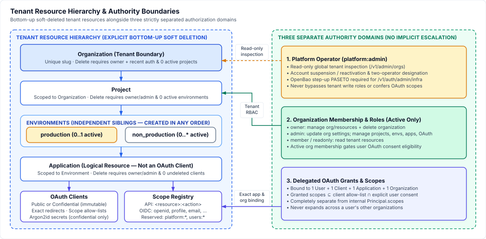

# Tenant resource lifecycle

Permesi's tenant hierarchy is Organization → Project → Environment → Application.
Applications own OAuth clients and their delegated scope registry. Resources are
soft-deleted explicitly from the bottom up; no endpoint recursively deletes a
populated tenant hierarchy. Existing rows and historical bindings remain in PostgreSQL.

*Source: [diagrams/tenant-authorization-model.d2](diagrams/tenant-authorization-model.d2)*

Delete each application's OAuth clients first, including disabled registrations.
The existing client deletion transaction disables and soft-deletes the client and
permanently revokes its credentials and saved consent. The application can then be
deleted. Immutable OIDC registry entries (`openid`, `profile`, `email`, `address`,
`phone`, `offline_access`) and application scope descriptions are retained metadata
and do not block application deletion. Keeping client deletion explicit reuses the
reviewed OAuth revocation lifecycle and prevents an application action from silently
destroying several independently configured integrations.

Delete all active applications before deleting an environment, all active environments
before deleting a project, and all active projects before deleting an organization.
Each populated parent returns 409 with its immediate child type. Soft-deleted children
do not block their parent, and deletion never physically removes a row. Normal tenant
resolution and OAuth management filter deleted ancestors; authorization, pending
consent and transactional code redemption reject inactive ancestry and revoked clients.
Outstanding authorization codes do not regain validity if a name or slug is reused.

## API and authorization

| DELETE endpoint | Required empty child set | Organization role |
| --- | --- | --- |
| `/v1/orgs/{org_slug}/projects/{project_slug}/envs/{env_slug}/apps/{app_id}` | Undeleted OAuth clients, including disabled clients | Owner or admin |
| `/v1/orgs/{org_slug}/projects/{project_slug}/envs/{env_slug}` | Active applications | Owner or admin |
| `/v1/orgs/{org_slug}/projects/{project_slug}` | Active environments | Owner or admin |
| `/v1/orgs/{org_slug}` | Active projects | Owner only, with recent authentication |

All operations require an active user account, a full authenticated session and current
active organization membership. Platform administrator permissions do not bypass tenant
roles. Missing or unsuitable sessions return 401; inaccessible, foreign, deleted and
repeated targets return 404. Successful deletion returns 204. Organization deletion reuses the existing
ten-minute recent-authentication policy used for high-risk account operations; a
stale authentication returns the stable `reauthentication_required` error code and
the console offers inline password verification. Verification only refreshes authentication
time; a separate explicit confirmation is still required. Production errors use the standard JSON envelope.

Deletion locks ancestry from the organization toward the target inside one PostgreSQL
transaction. Ancestors use SHARE locks, the target uses UPDATE, and current membership
and role rows, plus the active user row, remain locked through commit. The immediate-child
check happens after the target lock is acquired. Project, environment and application
creation hold SHARE locks on active parents in their own insertion transactions; OAuth client/scope creation
likewise rechecks and locks application ancestry. For hierarchy children and OAuth
clients, PostgreSQL serialization guarantees that creation wins and deletion returns
409, or deletion wins and creation returns 404. Scope creation also rejects a deletion
that wins first; a scope created before deletion remains retained metadata and does
not prevent application deletion.
This works across independent replicas without local state. The coordination is in
the API storage layer; arbitrary administrative SQL is not a supported lifecycle API.

Hierarchy mutations now use configurable [handler and PostgreSQL deadlines](tenant-mutation-deadlines.md).
Budget exhaustion returns the existing generic 503 envelope. Local settings preserve
stricter database limits and reset after transaction completion. Callers must reconcile
ambiguous outcomes before retrying; no deletion is retried automatically. Row locks
continue enforcing lifecycle consistency; sustained-load writer fairness remains separate.

## Console

`GET /v1/orgs/{org_slug}/capabilities` requires a full active session and active membership.
It returns only `organization_id`, `can_manage_resources` (owner/admin) and
`can_delete_organization` (owner), with `Cache-Control: no-store` on every response produced by the handler.
Framework path-extraction errors contain no capability hints and bypass the handler.
These flags describe role eligibility, not emptiness or recent authentication, and never
supply authority to a mutation. Raw roles and internal platform permissions are omitted.

Organization DELETE accepts the optional `X-Permesi-Expected-Organization-Id` UUID header.
The console always sends the originally confirmed organization ID; a slug resolving to
a different UUID returns 404, malformed or repeated headers return 400. The condition
only narrows an already authorized target. Existing clients omitting it remain compatible,
and the usual UUID pin inside the deletion transaction remains enforced. The configured
CORS allow-list permits this header without broadening allowed origins.

Each eligible resource page has a separate Danger Zone. Controls remain hidden until
capabilities load: members/read-only users see none, admins see child-resource actions,
and owners may see organization deletion. Immediate-child blockers explain the
next necessary action. A native Dialog requires the exact application name or resource
slug, preserves errors and typed confirmation on conflicts and transient deletion failures, and prevents
dismissal during a pending mutation. A 409 refreshes the immediate-child list while
preserving the dialog's error and typed confirmation. After success the console navigates
to the parent and loads its current collection; organization deletion returns to `/console/orgs`.
Capability hints refresh when a confirmation opens and after authorization failures.
Changed account/organization identity or lost eligibility closes the dialog and clears
the draft; permission loss is announced by an alert outside the dialog. A failed
capability refresh also hides the action until the page is reloaded, except a transient
failure during password verification keeps a recoverable password step that cannot submit DELETE.
Organization recent-authentication errors open a password step in the same Dialog. The
existing admission-protected OPAQUE start/finish handlers verify the password without
receiving plaintext, then the console reloads session identity, capabilities and projects.
Successful verification preserves the typed slug and returns focus to confirmation; it
never automatically retries DELETE. Auto-repeated Enter is ignored in the form so a
held password-submit key cannot confirm deletion; a fresh Enter press remains accessible.
New projects block confirmation, loss of the owner
role closes it, and changed accounts or organization IDs invalidate the draft. Stale
responses after route/account changes are ignored. Password fields clear on every
attempt, cancellation and unmount; passwords are absent from URLs, storage and logs.
Browser checks remain usability hints, and the backend enforces current state.

Console cards emphasize names with muted entity icons and a header divider.
Shared `MetaItem` rows use three section-wide subgrid tracks
(`1rem max-content minmax(0, 1fr)`): fixed icon, content-sized visible label and
wrapping value, with a 0.5rem row gap. Copy buttons follow the final value chunk
inline inside the `dd`, not in a trailing action column. Labels align without wide
empty columns or stretched label/value gaps; missing values read “Not set” or “None”.
`DateTime` defaults to
`Oct 5, 2026 · 07:04 UTC`, retaining exact ISO in `datetime` and `title`; invalid
input remains unchanged. `CopyValue` copies complete values through named,
keyboard-accessible controls with reserved success feedback and visible failures.
Whole-card links contain no interactive copy controls; identifiers remain available
on detail pages. One-time secret disclosure and its dismissal rules are unchanged.
Refresh actions reuse existing resources without retrying mutations or resetting
configuration drafts. OAuth scope Edit/Delete actions retain visible labels and
semantic icons; Delete has destructive light/dark styling, both remain keyboard
accessible, and system OIDC entries remain read-only.

The current phase adds no restore, purge, resource move or recursive cascade API.
Token issuance and rotating refresh families are implemented in the separate OAuth
milestones. Sustained load testing and fair ancestor-writer coordination remain part
of the operations roadmap; bounded mutation waits establish no production latency SLO.
Existing organization metadata DTOs continue to omit roles; the separate capability
contract supplies presentation hints without changing mutation authorization.

OPAQUE login and reauthentication now use [shared encrypted PostgreSQL exchanges](opaque-exchanges.md).
Start/finish can reach different replicas; elevation is bound to the original session
and expires with the server-issued exchange. [WebAuthn/passkey ceremonies](webauthn-exchanges.md)
also persist in shared PostgreSQL; remaining MFA/quota milestones are tracked in TODO.md.
OAuth authorization requests/codes and tenant lifecycle coordination remain PostgreSQL-backed.

## Testing and scope limits

PostgreSQL regressions cover both queue orders for child/client creation against
deletion, post-wait membership/role/user revalidation, resolved organization UUID
pinning across slug reuse, and rejection of pending consent and outstanding codes
after teardown. Browser tests (`just web-test-browser`) cover keyboard/focus
accessibility, dark/mobile styling, typed confirmation, pending-dialog protection,
409 child-list refresh, held-Enter repeat rejection, and real OPAQUE/PostgreSQL
organization deletion.

Current UX scope limits tracked in [TODO.md](../TODO.md):

- Organization DELETE authorizes the active session cookie even if another browser tab
  switched accounts after the last refresh (only an owner of the pinned UUID with recent
  authentication can succeed); optional expected-account verification and UUID guards
  for slug-addressed child deletions remain planned.
- Ambiguous DELETE timeouts require explicit state reconciliation rather than automatic
  retry, and a failed capability refresh requires reloading the page.
- Fair ancestor-writer coordination under sustained read load remains planned.
