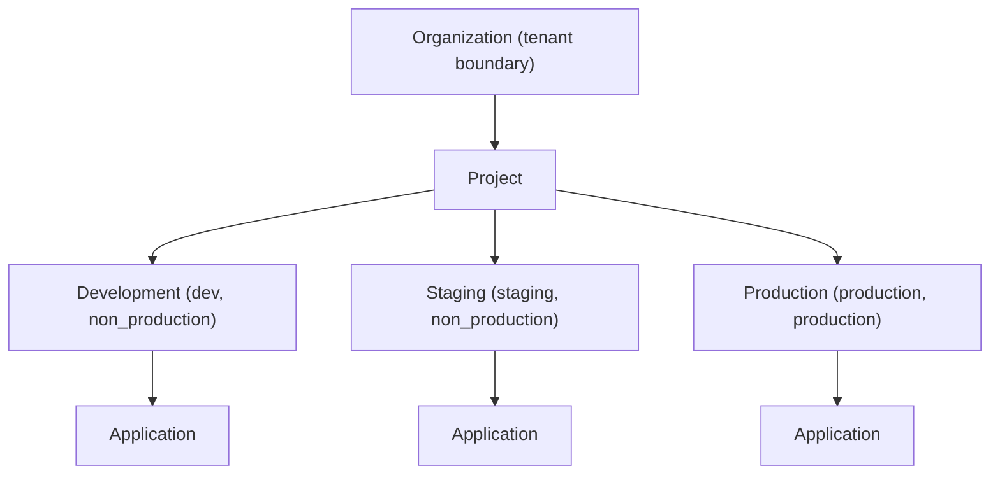
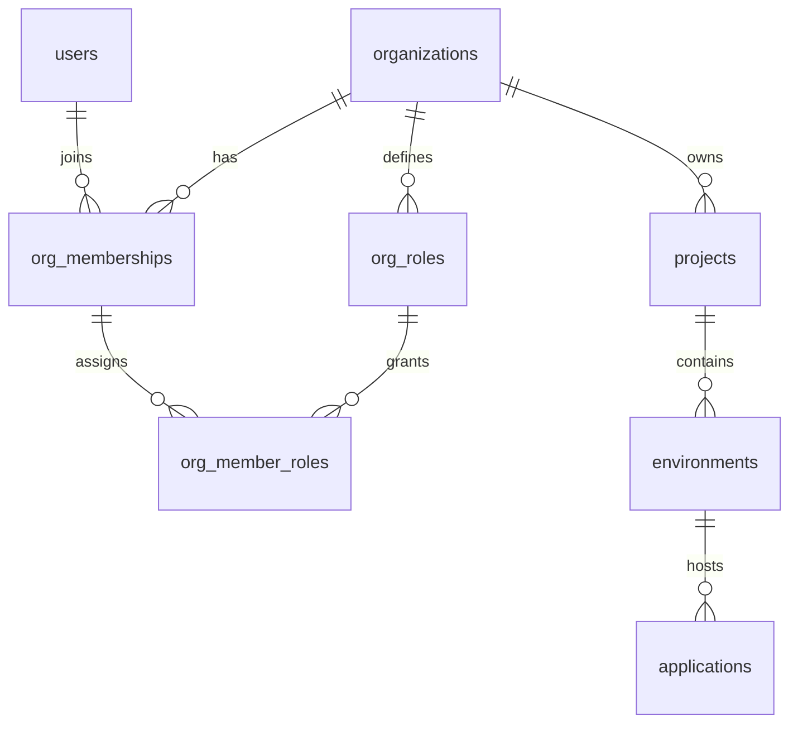

# permesi

Core IAM/OIDC authority.

## OpenBao requirement

OpenBao is required in production for authentication, dynamic DB creds, and transit encryption. Running without OpenBao is not supported.
See the canonical checklist in `../../README.md#openbao-dependency` and the OpenBao ops notes in `../../openbao/README.md`.
TL;DR:
- Run OpenBao in HA with tested failover.
- Use auto-unseal or keep a documented unseal runbook.
- Alert on health, sealed state, and token/lease renew failures.

When OpenBao token renewal or the DB lease renewal fails repeatedly, `permesi` shuts down with an error so your supervisor can restart it and force a fresh OpenBao login (especially important during standby/active transitions). `permesi` also fails closed when `/ready` (and the detailed `/health`) sees Postgres authentication-style failures (for example expired/revoked dynamic users), so those credential failures trigger a restart and fresh credential fetch.

On `SIGTERM` or `SIGINT` (Kubernetes pod termination, `systemctl stop`, Ctrl-C), `permesi` stops accepting connections and lets in-flight requests finish for up to 20 seconds (`--shutdown-drain-seconds` / `PERMESI_SHUTDOWN_DRAIN_SECONDS`, range 1-50: the drain and the shutdown after it have to end within the 60 seconds of validity kept before a lease runs out), then stops the email outbox worker at a batch boundary, flushes telemetry, removes its Unix socket when serving on one, and exits with status 0. The fail-closed shutdowns above use the same drain but exit with an error so the supervisor restarts the process. A second `SIGTERM` or `SIGINT` during the drain ends it immediately. When the drain ends, by its limit or by that second signal, a request still in a handler is abandoned: its handler is dropped, an open transaction rolls back, and the caller gets `503`. What follows the drain is bounded as well: 4 seconds for background workers, 4 for the database pool and, when traces are exported, about 5 for the telemetry flush. A stop therefore takes about 28 seconds at most with the default drain, or about 33 with trace export, plus whatever blocking work a dropped handler had already started, so give the supervisor a grace period of 35 seconds or more (the Helm charts set 60). The second signal shortens only the drain; the steps after it always run.

Two more deadlines apply to every request. `--request-timeout-seconds` / `PERMESI_REQUEST_TIMEOUT_SECONDS` (default `60`, range 1-600) is the longest any request may take to be answered; a slower one gets `503` and its handler is dropped. It has to be longer than `--oauth-token-timeout-ms`, so the token endpoint answers a slow exchange in the OAuth error format before the request is cut off. `--header-read-timeout-seconds` / `PERMESI_HEADER_READ_TIMEOUT_SECONDS` (default `10`, range 1-60, at most the request timeout) is how long a connection on the TCP/TLS listener may take to deliver a request's headers before it is closed; on the Unix socket the same-host reverse proxy enforces its own client timeouts. The timed-out answer carries `Cache-Control: no-store`. On an idle HTTP/1 keep-alive connection the header timer closes the connection, so clients reconnect after that long without a request. Requests after the first on an HTTP/2 connection have no header deadline in the service; put that bound in the proxy or load balancer if untrusted HTTP/2 clients reach the TLS listener directly.

## CLI example

The `dsn` can omit username/password because OpenBao injects DB creds (e.g. `postgres://postgres@localhost:5432/permesi`).
Core OpenBao supplies the approved admission versions and withdrawal floor.
Admission tokens use RFC3339 `iat` / `exp` claims.

Local dev note: when running the workspace frontend (Trunk on `:8081` behind HAProxy), use `--port 8001` to avoid collisions.

When serving over TCP/TLS (that is, without `--socket-path`), `permesi` first binds `[::]:PORT`
with dual-stack enabled so one listener can accept both IPv6 and IPv4 traffic. If the host does
not provide a usable IPv6 stack, it falls back to `0.0.0.0:PORT`.

### TCP Mode (AppRole)

`--openbao-url` accepts an OpenBao origin (`http(s)://host[:port]`) or an explicit AppRole login URL. An origin is completed to the standard AppRole login path; any other URL is used as-is (its path and query preserved). Requires role-id and secret-id (or wrapped token).

```sh
 cargo run -p permesi --bin permesi -- \
   --port 8001 \
   --dsn "postgres://postgres@localhost:5432/permesi" \
   --tls-pem-bundle "certs/permesi/tls.bundle.pem" \
   --openbao-url "https://openbao:8200/v1/auth/approle/login" \
   --openbao-role-id "$PERMESI_ROLE_ID" \
   --openbao-secret-id "$PERMESI_SECRET_ID"
 ```
 
 ### Agent Mode (Unix Socket)
 
 `--openbao-url` points to the OpenBao Agent `api_proxy` socket. No authentication args required.
 
 ```sh
 cargo run -p permesi --bin permesi -- \
   --port 8001 \
   --dsn "postgres://postgres@localhost:5432/permesi" \
   --tls-pem-bundle "/run/permesi/tls.bundle.pem" \
   --openbao-url "/run/openbao/proxy.sock"
 ```

### Native Kubernetes authentication (opt-in)

`--openbao-auth-method` / `PERMESI_OPENBAO_AUTH_METHOD` defaults to `auto`: sockets use
Agent and TCP uses AppRole. Explicit `approle` or `kubernetes` requires TCP; failed
login never falls back. Agent remains recommended when it also renders PKI.

For native login, set `--openbao-url https://openbao.example:8200 --openbao-auth-method kubernetes
--openbao-kubernetes-role permesi`. The URL must be an OpenBao origin without credentials,
path, query or fragment. Omit all AppRole role-id, secret-id and wrapped-token settings.
`--openbao-kubernetes-auth-mount` / `PERMESI_OPENBAO_KUBERNETES_AUTH_MOUNT` defaults to
`kubernetes` and accepts a relative mount (including nested mounts), without `/v1/auth/`,
traversal, query or empty segments. `--openbao-kubernetes-role` /
`PERMESI_OPENBAO_KUBERNETES_ROLE` is required only in Kubernetes mode.
`--openbao-kubernetes-token-path` / `PERMESI_OPENBAO_KUBERNETES_TOKEN_PATH` defaults to
`/var/run/secrets/kubernetes.io/serviceaccount/token`; use a read-only audience-scoped
projected token instead of broad default automount. Kubernetes-only settings are
rejected in other auth modes.

Each login reads the current JWT file and requires a usable renewable OpenBao token
with a positive lease. The existing renewal worker owns that token; repeated token
or database renewal failure shuts down fail-closed. A supervisor restart logs in with
the current projection and reacquires database credentials. This is restart-based
reauthentication, not seamless hot token replacement. See the
[OpenBao native-auth operations notes](../../openbao/README.md#native-kubernetes-authentication)
for role/audience boundaries and reviewer permissions; the application ServiceAccount
must not receive TokenReview privileges.

## Database schema

The base schema lives in `db/sql/02_permesi.sql`. Load it into Postgres with (only if you did not
run `db/sql/00_init.sql`):

```sh
psql "$PERMESI_DSN" -v ON_ERROR_STOP=1 -f db/sql/02_permesi.sql
```

The schema enables `citext`, so the role running it must have `CREATE EXTENSION` privileges on
the database.

`db/sql/` is the single source of truth for dev, containers, and bare-metal production schemas.

OpenBao-managed DB credentials also require bootstrap roles and grants. The canonical SQL for those
roles lives in `db/sql/00_init.sql`; it also applies the Permesi schema. For production, update the
passwords before running it, or apply the schema directly as shown above.

`db/sql/verify_permesi.sql` is a transactional smoke test that rolls back all changes. Run it
after loading the schema to verify constraints and defaults:

```sh
psql "$PERMESI_DSN" -v ON_ERROR_STOP=1 -f db/sql/verify_permesi.sql
```

## OPAQUE auth + email verification

`permesi` uses OPAQUE for signup/login. Passwords never leave the client; the database stores only
the OPAQUE registration record (`opaque_registration_record`).

### API router (OpenAPI-aware)

`permesi::api::router()` returns an `OpenApiRouter<AppState>` with all documented routes registered
via `#[utoipa::path]`. Use it to build a server or to split out the OpenAPI spec in tests.

```rust
let (router, openapi) = permesi::api::router().split_for_parts();
let app = router.with_state(state); // state: permesi::api::AppState
```

Every error response (4xx/5xx) uses one JSON body, `{"error": {"code": "...", "message": "..."}}`,
with `content-type: application/json`. `code` is stable and machine-readable (`invalid_request`,
`unauthenticated`, `forbidden`, `not_found`, `method_not_allowed`, `conflict`, `payload_too_large`,
`unsupported_media_type`, `rate_limited`, `dependency_unavailable`, `internal_error`); clients should
branch on it rather than on `message`, which is human-readable text capped at 256 characters. Handler
errors, malformed request bodies, unknown routes, and unsupported methods all use this shape, and the
OpenAPI document declares it as `ErrorEnvelope` on every error response. The auth endpoints keep their
deliberately generic messages (no account enumeration), and their codes depend only on the status.

Handlers receive shared dependencies through axum `State` extractors (`State<PgPool>`,
`State<Arc<AuthState>>`, ...) derived from `AppState` with `FromRef`, so routing a handler whose
dependency the state does not provide fails to compile instead of returning a runtime 500 from a
missing `Extension` layer. Per-request values such as the request ID stay request extensions.

Every response carries an `x-request-id` header holding a ULID issued by the server for that request. The same ID is recorded on the request's `http.request` trace span, so a failing response can be matched to its log lines. A client-supplied `x-request-id` is never adopted as the correlation ID; it is only logged as `client_request_id`, and only when it is at most 128 visible ASCII characters.

Endpoints:

- `GET /live`
- `GET /ready`
- `GET /health`
- `POST /v1/auth/opaque/signup/start`
- `POST /v1/auth/opaque/signup/finish`
- `POST /v1/auth/opaque/login/start`
- `POST /v1/auth/opaque/login/finish`
- `POST /v1/auth/opaque/reauth/start`
- `POST /v1/auth/opaque/reauth/finish`
- `POST /v1/auth/opaque/password/start`
- `POST /v1/auth/opaque/password/finish`
- `POST /v1/auth/passkey/login/start`
- `POST /v1/auth/passkey/login/finish`
- `POST /v1/auth/verify-email`
- `POST /v1/auth/resend-verification`
- `GET /v1/me`
- `PATCH /v1/me`
- `GET /v1/me/sessions`
- `DELETE /v1/me/sessions/{sid}`
- `POST /v1/me/webauthn/register/options`
- `POST /v1/me/webauthn/register/finish`
- `GET /v1/me/webauthn/credentials`
- `DELETE /v1/me/webauthn/credentials/{credential_id}`
- `POST /v1/orgs`
- `GET /v1/orgs`
- `GET /v1/orgs/{org_slug}`
- `PATCH /v1/orgs/{org_slug}`
- `POST /v1/orgs/{org_slug}/projects`
- `GET /v1/orgs/{org_slug}/projects`
- `POST /v1/orgs/{org_slug}/projects/{project_slug}/envs`
- `GET /v1/orgs/{org_slug}/projects/{project_slug}/envs`
- `POST /v1/orgs/{org_slug}/projects/{project_slug}/envs/{env_slug}/apps`
- `GET /v1/orgs/{org_slug}/projects/{project_slug}/envs/{env_slug}/apps`

For API testing workflows, this service keeps request collections in `services/permesi/openapi/` and Schemathesis contract-test configuration in `services/permesi/openapi/schemathesis/`. The workspace recipe `just schemathesis-permesi` runs OpenAPI-driven checks against `docs/openapi/permesi.json` and supports optional authenticated headers via environment variables.

Zero tokens (`X-Permesi-Zero-Token`, minted by `genesis`) are required on abuse-sensitive auth
entrypoints such as OPAQUE start/finish, passkey login start/finish, and email
verify/resend flows. Tokens are validated locally against the current core OpenBao snapshot. Session-bound routes (for example `/v1/auth/session`, `/v1/auth/logout`, `/v1/auth/admin/*`,
`/v1/me/*`, and `/v1/orgs/*`) use the session cookie instead. Password changes require a recent
re-auth (default 10 minutes) and revoke all sessions once the new registration record is stored.

### Session and Admin Step-up Flow

Browser clients authenticate with the `permesi_session` cookie. Admin bootstrap/elevation calls
(`POST /v1/auth/admin/bootstrap` and `POST /v1/auth/admin/elevate`) require this cookie-backed
session and accept the OpenBao token in the JSON request body. On successful elevation, `permesi`
records a short-lived elevation for that exact session in PostgreSQL and returns its expiry. The
same cookie then authorizes `GET /v1/auth/admin/infra` on any replica until the elevation expires or
the session ends. No admin bearer token exists; see
[operator designation](../../docs/operator-designation.md#admin-elevation).

### Passkeys (WebAuthn)

Passkeys are stored in the `passkeys` table and serialized using the `webauthn-rs` `Passkey`
type to preserve counters and backup state. Passkey login issues the same session kinds as
password login (full, MFA bootstrap, or MFA challenge) based on the stored MFA state.
By default, both passkeys and MFA security keys accept the primary frontend origin plus any
configured CORS origins whose host matches the configured WebAuthn RP ID or one of its
subdomains. This keeps alternate trusted frontends such as `https://k8s.permesi.dev` working
without widening the RP trust boundary to unrelated origins.

Set `PERMESI_PASSKEYS_PREVIEW_MODE=true` to disable persistence and login while still allowing
registration verification (useful for staged rollouts).

### Organization endpoints and authorization

Self-service user operations must use `/v1/me/*` and resolve the user from the session cookie.
Session authentication is cookie-based for browser flows, including the operator step-up.
`Authorization: Bearer` is used for OAuth access tokens (`/userinfo`), never for a user session
or an operator elevation.
Organization, project, environment, and application routes are scoped by org slug and require
active membership. Org roles (`owner`, `admin`, `member`, `readonly`) are enforced server-side:
owner/admin can mutate org resources; member/readonly are read-only. Unauthorized access is
returned as 404 to avoid resource enumeration.

Environments are independent siblings owned directly by a Project. Their tier
(`production` or `non_production`) is a security/operational classification, not an
identity or creation prerequisite. Names and slugs identify development, QA, staging,
or other environments. Each Project may have zero or one active production environment
and any number of non-production environments, created in either order. The PostgreSQL
partial unique index on `environments(project_id)` where `tier = 'production'` and
`deleted_at IS NULL` enforces the production limit, including concurrent inserts.
Soft-deleting production releases the slot; non-production never depends on it.

Organization slugs are normalized to lowercase, URL-safe identifiers and must be 3–63
characters (`[a-z0-9-]`, no leading/trailing hyphen). If omitted, the slug is derived from the
name and auto-suffixed (`-2`, `-3`, …) on conflict. Project slugs follow the same rules but are
unique per org and return conflicts instead of auto-suffixing. Environment slugs are 2–32
characters with the same URL-safe rules and are unique per project.

Membership status gates authorization: only `active` members may read or mutate org resources.
Invited or suspended memberships behave as unauthorized for all org/project/env/app routes and
return 404s to avoid leaking resource existence.
Soft deletes do not reserve slugs or names: uniqueness is enforced only for rows where
`deleted_at` is null, so deleted orgs/projects/environments/apps can reuse identifiers.

Hierarchy mutations use `PERMESI_TENANT_LOCK_TIMEOUT_MS` (default 1000 ms, 1–10000)
and `PERMESI_TENANT_MUTATION_TIMEOUT_MS` (default 5000 ms, 1–30000); the lock budget
cannot exceed the handler budget. `PERMESI_TENANT_SLUG_ATTEMPTS` defaults to 16
organization slug candidates (1–128), with exhausted collisions returning 409.
PostgreSQL limits are transaction-local and preserve
stricter existing database limits. Exhaustion returns generic 503; reconcile ambiguous
outcomes before deliberate retry. See [mutation deadlines](../../docs/tenant-mutation-deadlines.md)
for coverage, cancellation and sustained-load limits.

Tenant model overview:



Database hierarchy (core tables + membership):



### How to create an org → project → env → app

1) Authenticate and obtain a session cookie via the OPAQUE login flow.
2) Create an organization (owner/admin only once created):

   `POST /v1/orgs` with `{ "name": "Acme", "slug": "acme" }`

3) Create a project inside the org (owner/admin required):

   `POST /v1/orgs/acme/projects` with `{ "name": "Payments", "slug": "payments" }`

4) Create a development environment; production does not need to exist:

   `POST /v1/orgs/acme/projects/payments/envs` with
   `{ "name": "Development", "slug": "dev", "tier": "non_production" }`

5) Add sibling environments in any order. For example, staging and then production:

   `POST /v1/orgs/acme/projects/payments/envs` with
   `{ "name": "Staging", "slug": "stage", "tier": "non_production" }`

   `POST /v1/orgs/acme/projects/payments/envs` with
   `{ "name": "Production", "slug": "prod", "tier": "production" }`

   Creating production first is equally valid; only a second active production
   environment conflicts.

6) Create an application under an environment:

   `POST /v1/orgs/acme/projects/payments/envs/dev/apps` with `{ "name": "payments-api" }`

Always use opaque user IDs in paths. Avoid putting emails in URLs because they leak PII into logs
and proxies, complicate normalization (case/encoding), and make enumeration easier. If a flow
needs an email, keep it in the request body and apply the same rate limiting and audit controls.

### Email outbox (transactional)

Signup/resend requests enqueue email work in `email_outbox` during the same DB transaction that
creates the user + verification token. A background worker polls for `pending` rows, locks a
batch with `FOR UPDATE SKIP LOCKED`, and hands each row to an `EmailSender` implementation.
Success marks the row `sent`; failures are retried with exponential backoff + jitter using
`next_attempt_at` until max attempts is reached (default 5), then marked `failed`.
Defaults: base delay 5s, max delay 5m.

The default delivery mode (`--email-delivery outbox`) leaves rows pending without
logging verification links (use `just signup-verify-url` in local development).
For production mail delivery, configure `--email-delivery smtp` with explicit TLS
(`implicit` on port 465 or mandatory `starttls` on port 587) and durable worker
leases; see [registration security](../../docs/registration-security.md#email-delivery).
For current scale, the DB outbox keeps infrastructure minimal and consistent.

### Token cleanup (pg_cron or system cron)

Expired sessions and verification tokens can be purged by calling `cleanup_expired_tokens()` in
the permesi database. Use `db/sql/maintenance.sql` as a manual helper, or schedule the call via
pg_cron as described in `SETUP.md`.

`db/sql/maintenance.sql` is a manual helper that invokes the cleanup once. Scheduling is
centralized in `db/sql/cron_jobs.sql` (run against `postgres`).

See `SETUP.md` for the canonical `pg_cron` setup steps.

```sql
SELECT cleanup_expired_tokens();
```

### OPAQUE seed (OpenBao KV v2)

OPAQUE server setup is derived from a 32-byte seed stored in OpenBao KV v2:

- Mount: `--opaque-kv-mount` / `PERMESI_OPAQUE_KV_MOUNT` (default: `secret/permesi`)
- Fields:
  - `opaque_server_seed` (base64-encoded 32 bytes)
  - `mfa_recovery_pepper` (base64-encoded string)

To initialize these in OpenBao:

- Generate 32 random bytes and store the base64 value as `opaque_server_seed`.
- Generate a random string and store it as `mfa_recovery_pepper`.
- Example:
  ```bash
  OPAQUE_SEED=$(openssl rand -base64 32)
  MFA_PEPPER=$(openssl rand -base64 32)
  bao kv put secret/permesi/config opaque_server_seed="$OPAQUE_SEED" mfa_recovery_pepper="$MFA_PEPPER"
  ```

Rotation:
- Rotation is not routine: changing the seed invalidates all existing OPAQUE registration records.
- Only rotate if the seed is compromised or you plan a forced re-registration/reset for all users.
- There is no dual-seed support today; rotation requires a coordinated maintenance window.

Maintenance:
- Treat the seed as a long-lived secret; restrict read access to the `permesi` runtime.
- Back it up in your secret manager; losing it makes all existing registrations unusable.

### Auth config flags

- `--frontend-base-url` / `PERMESI_FRONTEND_BASE_URL` (verification link base, default `https://permesi.dev`)
- `--email-token-ttl-seconds` / `PERMESI_EMAIL_TOKEN_TTL_SECONDS`
- `--email-resend-cooldown-seconds` / `PERMESI_EMAIL_RESEND_COOLDOWN_SECONDS`
- `--opaque-server-id` / `PERMESI_OPAQUE_SERVER_ID` (default `api.permesi.dev`)
- `--opaque-login-ttl-seconds` / `PERMESI_OPAQUE_LOGIN_TTL_SECONDS`

### MFA config flags

- `--mfa-required` / `PERMESI_MFA_REQUIRED` (`true` or `false`, default `false`; `true` requires MFA bootstrap for new sessions, and any other value fails startup)

### Email outbox worker flags

- `--email-outbox-poll-seconds` / `PERMESI_EMAIL_OUTBOX_POLL_SECONDS` (default `5`)
- `--email-outbox-batch-size` / `PERMESI_EMAIL_OUTBOX_BATCH_SIZE` (default `10`)
- `--email-outbox-max-attempts` / `PERMESI_EMAIL_OUTBOX_MAX_ATTEMPTS` (default `5`)
- `--email-outbox-backoff-base-seconds` / `PERMESI_EMAIL_OUTBOX_BACKOFF_BASE_SECONDS` (default `5`)
- `--email-outbox-backoff-max-seconds` / `PERMESI_EMAIL_OUTBOX_BACKOFF_MAX_SECONDS` (default `300`)

### Database pool flags

- `--db-max-connections` / `PERMESI_DB_MAX_CONNECTIONS` (default `10`, range 1-200)
- `--db-min-connections` / `PERMESI_DB_MIN_CONNECTIONS` (default `2`, must not exceed the maximum)
- `--db-acquire-timeout-ms` / `PERMESI_DB_ACQUIRE_TIMEOUT_MS` (default `3000`, range 100-30000)
- `--db-idle-timeout-seconds` / `PERMESI_DB_IDLE_TIMEOUT_SECONDS` (default `600`, at least 10 and below the lifetime)
- `--db-max-lifetime-seconds` / `PERMESI_DB_MAX_LIFETIME_SECONDS` (default `1800`, range 60-86400)
- `--db-statement-timeout-ms` / `PERMESI_DB_STATEMENT_TIMEOUT_MS` (default `30000`, range 100-600000): session `statement_timeout` of every pooled connection
- `--db-lock-timeout-ms` / `PERMESI_DB_LOCK_TIMEOUT_MS` (default `5000`, range 100-60000, at most the statement timeout): session `lock_timeout` of every pooled connection
- `--db-allow-unverified-tls` / `PERMESI_DB_ALLOW_UNVERIFIED_TLS` (off by default): accept a DSN to a host that is not local without `sslmode=verify-full` or `verify-ca`

The service refuses to start with connections that can be read or impersonated on the network. A plain `http://` OpenBao address is accepted only when it stays on the machine: a loopback address (`127.0.0.0/8`, `::1`), or `localhost` or a name under it that resolves to loopback addresses only. For any other host use `https://`, or opt in with `--openbao-allow-insecure-http` / `PERMESI_OPENBAO_ALLOW_INSECURE_HTTP`. On that local plain path the client ignores `HTTP_PROXY` and the other proxy variables and connects only to the loopback addresses it found, so a proxy setting or a later change in name resolution cannot carry a token off the machine. An `https://` address still honours the proxy variables. An Agent socket is not affected.

A DSN whose connection is not local needs `sslmode=verify-full` or `verify-ca`, usually with `sslrootcert`, because the driver's default `prefer` falls back to clear text and never checks the certificate; `--db-allow-unverified-tls` opts out. Local means a Unix socket or a loopback address. What counts is the address the driver dials: `hostaddr` in the DSN, or `PGHOSTADDR`, replaces the host for that purpose, so `localhost` with a remote `hostaddr` is not local. A `localhost` name allowed without TLS for being local is pinned to the loopback address it resolved to at startup, so the driver does not resolve it again for later connections. A connection that fails is reported with its kind or SQLSTATE only. Both opt-outs exist for development clusters and are not meant for production; a service that relies on one says so at error level on every start.

The DSN is checked before the driver sees it. Its query may hold only the parameters the driver acts on: `sslmode`, `sslrootcert`, `sslcert`, `sslkey`, `host`, `hostaddr`, `port`, `dbname`, `application_name`, `options` and `statement-cache-capacity`. Any other parameter, including libpq's `connect_timeout`, is refused: the driver would ignore it and log its value. `user` and `password` in the query are refused as well, and a user or password before the `@` is replaced, because the service always connects with the credentials OpenBao issued. A refused DSN is never repeated in the error.

The session timeouts are set on each connection when it is opened, which holds for a direct connection and for a pooler in session mode. Behind PgBouncer in transaction mode a session setting does not stay with the service's transactions; set `statement_timeout` and `lock_timeout` on the database there instead (`ALTER DATABASE ... SET`). A setting on the shared runtime role does not reach the per-lease logins OpenBao creates, which only inherit its privileges.

The pool is shared by request handlers and background work. A request that cannot get a connection within the acquire timeout fails promptly instead of queueing for sqlx's 30 second default. Connections are labelled with `application_name` (`permesi`) in `pg_stat_activity`, and the pool is closed after the server drains. Recycling connections more often than the lifetime would not refresh credentials: the OpenBao-issued username and password are fixed for the life of the process, and a new database lease means a restart.

## Admission Token Verification

- `permesi` verifies Admission Tokens locally using approved public keys cached from core OpenBao.
- There is no online revocation check today; `jti` is not looked up in a database.

## Missing / Planned

- Optional revocation mode (DB lookup or cached revocation list) for stricter enforcement.

## Admin Rate Limiting

Endpoints under `/v1/auth/admin/*` (bootstrap and elevation) are strictly rate-limited to prevent brute-force attacks on OpenBao tokens.

- **Attempt Limit**: 3 attempts per user and 10 attempts per IP within a rolling 10-minute window.
- **Failure Cooldown**: 3 consecutive failed attempts (invalid OpenBao tokens) trigger a **15-minute cooldown** for the user.
- **Response**: `429 Too Many Requests` is returned when limits are exceeded. The `/v1/auth/admin/status` endpoint includes a `cooldown_seconds` field to help the UI surface the remaining time.

## OAuth 2.0 & OIDC

Applications own OAuth clients and a delegated `<resource>:<action>` scope registry
beneath the org/project/environment hierarchy. Management uses full sessions and
org roles (`owner`/`admin` mutate, active members read, unauthorized requests
return `404`). OAuth scopes are completely separate from internal `Principal.scopes`.

When `PERMESI_OIDC_ISSUER` and `PERMESI_OAUTH_AUDIENCE` are configured, Permesi
exposes `/.well-known/openid-configuration`, `/jwks.json`, `/authorize`
(Authorization Code + mandatory S256 PKCE), `/token` (OpenBao-signed RS256 access
and ID tokens, plus rotating refresh-token families after explicit offline consent),
`/revoke`, and `/userinfo`. See:

- [OAuth/OIDC foundation](../../docs/oauth-foundation.md)
- [Authorization-code token exchange](../../docs/oauth-token-exchange.md)
- [Refresh-token families](../../docs/oauth-refresh-tokens.md)
